# uniswap-lp-economics

**Who makes money on Uniswap V3?** A swap-by-swap study of the USDC/WETH 0.05% pool on Ethereum
mainnet against Binance: how fast the pool follows the CEX price, who closes the gaps, what each
flow type earns or loses (markouts), and what arbitrage bots keep after gas and builder payments.
Then the liquidity providers' side: whether LP fees cover loss-versus-rebalancing (LVR), which LPs
make money, and where the LVR goes.

[](https://github.com/samuraixx-key/uniswap-lp-economics/actions/workflows/ci.yml)


> **Status:** sub-projects 1 (data foundation), 2 (price discovery and markouts) and 3 (LP P&L and
> where LVR goes) are complete; data checks C1–C6, analysis checks A1–A6 and LP checks L1–L7 all
> pass. Next: reference robustness (sub-project 4: mid prices and OKX), then counterfactual LP
> strategies (sub-project 5).

## TL;DR

**Question.** In the USDC/WETH 0.05% pool from 2026-07-01 to 2026-10-01 (534,377 swaps, $7.05B
notional), which flow wins against the pool and which loses to it, measured against Binance? How
quickly does the pool follow Binance? And how much of the arbitrage edge do the bots keep after gas
and payments to block builders?

1. **Searchers win against the pool; flow through Uniswap's routers loses the most.** Trader
   markout at the block time (0 s) against Binance, notional-weighted, after the 0.05% swap fee:
   searchers (contracts that call the pool directly from transactions sent to them, typically
   bots; 75% of notional) **+2.86 bp** (95% day-bootstrap interval 2.38 to 3.50), +3.58 bp at
   12 s, while the median searcher swap is -0.57 bp (the notional-weighted mean is carried by larger
   swaps); Uniswap-router flow **-10.66 bp** (-11.28 to -10.01); aggregators -6.76 bp; other
   contracts -4.35 bp.
   *Caveat:* the reference is Binance's last trade at the block timestamp, and the searchers' 0 s
   edge moves with that choice (1.80 bp with t0 − 2 s, 3.34 bp against ETHUSDT). Every label keeps
   its sign in all four variants up to 5 minutes; at 1 h the intervals widen a lot. Markouts include
   the fee and each swap's own price impact, so uninformed flow is negative by construction.
2. **Binance leads; the pool follows in the next block.** Per-block returns correlate most at lag
   +1 block (0.59, against 0.06 at lag 0): the pool's move in a block tracks Binance's move in the
   12 s before it. The median absolute gap between the pool at block start and Binance is 3.08 bp;
   21.7% of blocks start outside the ±5 bp fee band; an AR(1) fit gives a half-life of 1.85 blocks
   (about 22 s). Searchers close 74% of the 70,290 gaps wider than 5 bp, and 92% of the 12,583
   wider than 10 bp.
   *Caveat:* all of this is at block resolution (12 s) against Binance's last trade, so it shows
   the pool updating at the first block that can react, not who discovers the price within a
   block; the AR(1) fits one decay rate to blocks inside and outside the band.
3. **Builders receive roughly all of the edge that is measurable at block time.** Arbitrage
   available at block starts (before gas, no Binance fee): $1.82M ($1.45M with a 1 bp Binance fee).
   Searchers' 0 s markouts total $1.51M. The four top bot contracts' single-pool transactions made
   $1.22M gross at 0 s and paid $1.40M to block builders (priority fees $0.54M, direct coinbase
   payments $0.86M; base fee burned $7.8k): builder income is 115% of gross, and "kept" is
   -$0.19M.
   *Caveat:* this does not mean the bots lose money. "Kept" is a small difference of large totals
   and its sign depends on the horizon: with the same costs, kept is −$0.19M at the 0 s markout and
   +$0.06M at 12 s (builder income 115% vs 95% of gross). Gross is measured against Binance's last
   trade at the block timestamp; the bots' own hedge price and timing are not observed, and the edge
   depends on t0 (searchers: 1.80 bp at t0 − 2 s, 2.86 bp at t0, 3.58 bp at 12 s). Binance-side
   fees, inventory and hedging are not observed either. Builder payments routed elsewhere are
   missed, which would make "kept" lower still: that is what "upper bound" means in the
   [limitation](#limitations).

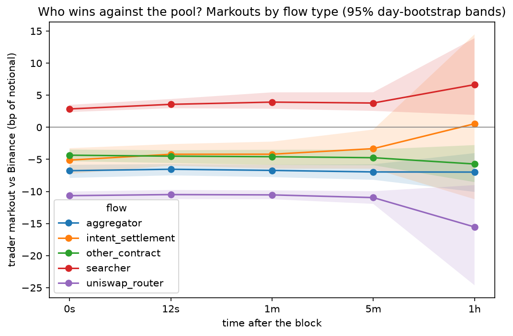

*Chart 1. Notional-weighted trader markout against Binance by flow label, from the block time to
1 h later, with 95% day-bootstrap bands. Positive = the swap won against the pool.*

**And for the liquidity providers.** Do the fees they earn cover LVR (what they lose by trading
at the pool's price instead of Binance's)? Which LPs make money? And where does the LVR go?

4. **LPs' fees, after the protocol's quarter, do not cover LVR.** Over the window LPs earned
   **$2.64M** in fees net of the protocol's quarter (which took $0.88M) and lost **$3.70M** to LVR
   measured at the block time ($4.09M at 12 s): LP fees − LVR = **−$1.06M**. LP fees fell short in
   every volatility tercile of days: −$0.15M on the 30 calmest days, −$0.23M on the middle 31 and
   −$0.68M on the 31 most volatile. The LVR formula of Milionis, Moallemi, Roughgarden and Zhang
   (2022), with 1-second Binance returns, gives $3.16M.
   *Caveat:* the protocol's quarter is most of the gap. Before it, total swap fees ($3.53M) fell
   short of LVR by only $0.18M, and all of that on the most volatile third of days (−$264k); on the
   calm and middle thirds total fees exceeded LVR (+$31.7k and +$54.2k), and LVR exceeded total
   fees on 41 of the 92 days. That matches sub-project 2's all-swaps markout of +0.25 bp
   (−0.14 to 0.77): the pool's counterparties as a whole roughly break even after the full fee.
   LVR here is measured swap by swap against Binance's last trade at the block time, net of all
   flow: searcher swaps alone cost LPs $4.14M, and the rest of the flow gave $0.44M back. It is the
   loss against a portfolio that rebalances at Binance's price, not a loss against holding. The
   theoretical value depends on sampling: 1-minute returns give $4.33M.
5. **Almost only just-in-time liquidity makes money.** Against a portfolio that rebalances at
   Binance's price, after gas, the 7,874 positions active in the window lost **$1.09M**. JIT
   positions (844, minted and burned in the same block) made +$13.9k, and most of it is negative
   LVR, not fees: the flow they trade with loses to the pool against Binance, which adds $28.9k,
   against $4.8k of fees and $19.8k of gas. Every other LP type lost between 1.35 and
   2.28 bp of position value per day, each with a 95% interval below zero: NFT positions held by
   wallets, which earned $2.57M of the $2.64M in fees, **−1.35 bp/day** (−1.77 to −1.12) and
   −$1.08M; vaults −1.58; NFT positions held by contracts −2.28; other direct positions −1.55.
   Against simply holding the deposited tokens, 24.1% of positions came out ahead within the
   window; over their whole life, 65.7% did (median return +0.03%), and 79% of positions with a
   life of 180 days or more.
   *Caveat:* the benchmark assumes the LP could hedge for free at Binance's last trade; LPs' hedges
   and other holdings are not observed, and LP gas before the window is not counted. The window
   result against holding (−$18.2M) is mostly the window's price path, not LVR. The lifetime
   results (65.7%, and 79% for lives of 180 days or more) depend in the same way on the price path
   over each position's own life, and so on when it opened and closed. Lifetime shares count
   positions, not dollars, and value deposits made before the window at ETHUSDT 1-minute closes.
   A vault stands for many depositors, and an NFT position's LP is its owner at close.
6. **Where LVR goes: back to LPs as fees, then to proposers and builders; searchers keep nothing
   measurable at block time.** Of the $4.14M of LVR on searcher swaps, 47.7% went to LPs as fees,
   15.9% to the protocol, 19.0% to block proposers and 15.8% to builders (margin after paying the
   proposer); 6.2% is the gross of multi-pool transactions (not split), 0.2% gas burned, and the
   searchers kept **−4.9%** (−$0.20M).
   *Caveat:* the builder/proposer split applies each block's ratio of proposer payment to builder
   revenue, not how a builder priced each transaction. On-chain proposer payments match relay
   data on 699 of the 769 sampled blocks found on a relay (90.9%, just above the 90% below which
   the method would have been investigated); the other 70 (9.1%) differ by more than 1% for a
   reason not established. Kept is negative because builder margin plus proposer payment (34.8% of
   searcher LVR) exceeds the single-pool gross at 0 s (30.2%). It is an upper bound (payments
   outside the transaction are missed) and, as in finding 3, a small difference of large totals
   measured at the block time; sub-project 2's positive kept at 12 s covers the top 4 bots only.

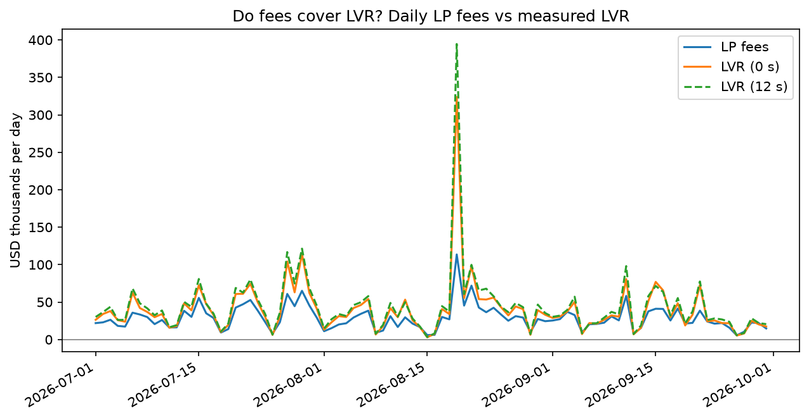

*Chart 7. LP fees (after the protocol's quarter) and measured LVR per UTC day, in USD thousands.
LVR at 0 s is above LP fees on 79 of the 92 days (counted from
[`results/lvr_daily.csv`](results/lvr_daily.csv)), and far above on the most volatile ones. Added
back, the protocol's quarter changes this: LVR is above total swap fees (LP + protocol) on 41 of
the 92 days.*

## Contents

- [Data](#data) · [Method](#method) · [Results](#results) · [LP P&L](#lp-pl) ·
  [Where LVR goes](#where-lvr-goes) · [Limitations](#limitations)
- [Reproduce](#reproduce) · [Repo map](#repo-map) · [Further reading](#further-reading)

## Data

Study window: `[2026-07-01, 2026-10-01)` UTC. Pool: USDC/WETH 0.05%
(`0x88e6a0c2ddd26feeb64f039a2c41296fcb3f5640`). Token0 is USDC (6 decimals), token1 is WETH
(18 decimals), fee 500 pips, tick spacing 10.

| Source | What | How |
|---|---|---|
| Uniswap V3 pool `0x88e6…5640` | All pool logs in the window (Swap, Mint, Burn, Collect, Flash, CollectProtocol), block timestamps, tx sender/recipient | BigQuery `bigquery-public-data.crypto_ethereum`, one file per month |
| Archive RPC | Full tick book at the snapshot block just before the window; pool state at 500 random blocks inside it | Starts the replay and validates it |
| Binance | ETHUSDC aggregated trades (one row per taker order at one price, µs timestamps; primary reference price) and ETHUSDT 1-second candles | [data.binance.vision](https://data.binance.vision), checksum-verified |

**What was collected.** 556,664 pool logs: 534,377 swaps, 5,616 mints, 8,115 burns, 8,119 collects,
57 flash and 380 collect_protocol. From Binance: 15,296,344 ETHUSDC trades and 7,948,800 ETHUSDT
1-second candles (complete).

**How liquidity is reconstructed.** Pool logs say what changed, not the full state, so the tick book
is rebuilt by replaying events in `(block, log_index)` order, starting from an on-chain snapshot of
the full tick book at block 25,433,938 (2026-06-30 23:59:59 UTC). State values (prices, liquidity)
are exact integers: Python `int` in code, `Int128` in Polars, and `Decimal(38, 0)` in the parquet
files (so pyarrow, pandas and DuckDB can read them too; use `uniswap_lp_economics.io.read_exact` to
get `Int128` back in Polars). Floats appear only in readable columns such as `amount_usdc`,
`amount_eth` and `price_usd`.

**Protocol fee.** Read from chain, `feeProtocol` is 68 (`0x44`) at the snapshot block and throughout
the window: the protocol takes 1/4 of every swap fee, in both tokens. There were no `SetFeeProtocol`
events in the window, and 380 `CollectProtocol` events. LP fee income in later stages therefore has
to be computed net of the protocol's quarter.

**Added for LP P&L (sub-project 3).** Positions open at the window start were created earlier, so
the pool's full history is needed to know their state and their LP:

| Source | What | How |
|---|---|---|
| Pool and NonfungiblePositionManager logs, 2021-05-04 to the window end | Every `Mint`/`Burn`/`Collect`, and the NFT positions' `IncreaseLiquidity`/`DecreaseLiquidity`/`Collect`/`Transfer` | BigQuery, one paid query (2.98 TB scanned) |
| Archive RPC | Fee-growth state at the snapshot and at the 500 sample blocks; every position's stored state at the window's start and end; whether each LP address has contract code | `eth_call` batched through Multicall3, `eth_getCode` |
| BigQuery transactions, traces and logs | Per block: builder revenue and proposer payment; per transaction touching the pool: payments to the block's fee recipient and logs from other contracts | Aggregated inside BigQuery (about 661 GB scanned) |
| MEV-Boost relays | Relay-reported proposer payments for 1,000 random window blocks | Public data APIs, cross-check only |
| Binance | ETHUSDT 1-minute candles since the pool's creation | data.binance.vision, checksum-verified |
| `labels/lp_addresses.csv` | Four LP vaults named on Etherscan, with source links | Curated |

### Validation

Full report: [`data_validation/validation_report.md`](data_validation/validation_report.md)
(machine-readable: `validation_report.json`, which also lists a SHA-256 prefix of every input file
and the git commit). Overall status: **PASS**.

| Check | What it compares | Result |
|---|---|---|
| C1 | Active liquidity from the replayed tick book vs the `liquidity` value emitted in each Swap event | 534,377 swaps, 0 mismatches |
| C2 | Each swap's reported tick vs the tick implied by its `sqrtPriceX96` | 534,377 swaps, 0 mismatches (2 of them stop exactly on a tick boundary) |
| C3 | Replayed state vs on-chain `slot0`, `liquidity()` and `ticks()` at 500 random blocks (5 of them with the full set of initialized ticks) | 500/500 blocks, 17,625 ticks compared, 0 mismatches, 0 blocks missing data |
| C4 | Snapshot self-consistency | 1,557 initialized ticks; `liquidity_net` sums to 0; rebuilt active liquidity 2,811,825,879,343,074,188 equals on-chain `liquidity()` |
| C5 | Raw data integrity | 556,664 logs, 0 duplicates, 0 without a transaction, 0 outside the window, 0 of unknown event type; 6 Binance files, no bad checksums |
| C6 | Pool price vs the last Binance ETHUSDC trade before each swap | 534,377/534,377 matched; median gap 3.757 bp (gated: must be below 10 bp); 95th percentile 6.656 bp (reported, not bounded) |

What this proves and what it does not:

- C1 and C3 are exact-integer comparisons. Together they show that our reconstruction of in-range
  liquidity matches the chain at every swap and at 500 randomly chosen blocks. The fee and LVR
  calculations depend on that. It is a statement about this pool and this window, not a general
  proof that the replay code is correct for other pools.
- C3 checks a sample of blocks and ticks (the 20 initialized ticks nearest the price at each block,
  taken from the on-chain bitmap, plus the full book at 5 blocks), not every tick at every block.
  C1 covers every swap; C3 checks more fields (ticks not crossed by swaps) at sampled blocks.
- The C6 median is a sanity bound that catches gross errors such as a wrong decimal or an inverted
  price. It is not a finding, and it says nothing about who gains or loses from the pool/CEX gap.
- C5 reports a longest gap of 169.371924 s between consecutive Binance ETHUSDC trades. That is a
  property of the data, not a defect, but the CEX price at a swap can be that stale in quiet periods.

## Method

Every definition and formula: [`docs/methodology.md`](docs/methodology.md).

1. **Reference and time zero:** Binance's last ETHUSDC trade at or before the time; t0 = block
   timestamp; horizons 0 s, 12 s, 1 min, 5 min and 1 h.
2. **Markouts:** each swap's trader-side gain or loss against that price, after the swap fee, in USD
   and bp of notional; notional-weighted by group, with 95% intervals from a day bootstrap.
3. **Flow labels:** a curated address list (Uniswap routers, aggregators, intent settlement), then
   `searcher` when the pool's caller is the transaction's target, else `other_contract`.
4. **Price discovery:** per-block basis between pool and Binance, gap episodes and who closes them,
   cross-correlation of returns, AR(1) half-life of the basis.
5. **Available → captured → kept:** optimal arbitrage at each block start by exact-integer V3 swap
   simulation; searchers' 0 s markouts; the top bots' gross minus gas and builder payments.
6. **Positions and fees, exactly as the contract keeps them:** every swap is re-simulated step by
   step, and the pool's fee-growth accounting is replayed in exact integers alongside parallel
   float accumulators for USD fees and LVR. Positions are rebuilt from the pool's full history (one
   per NFT; direct positions split each time their liquidity returns to zero), and their stored
   state matches the chain at both ends of the window.
7. **LVR and P&L:** measured LVR per swap step = the pool's token change, fee excluded, valued at
   Binance (`−(Δusdc + Δeth × P_cex)`); theoretical LVR from realised variance and the active
   liquidity. Per position: P&L against rebalancing (fees − LVR − gas) and against holding, in bp
   of hourly time-weighted value per day, with 95% bootstrap intervals over positions; and a
   lifetime result against holding.
8. **Where LVR goes:** LVR on searcher swaps → LP fees, protocol fees and the searchers' gross;
   gross → gas burned, builder margin, proposer payment and what the searcher kept, using every
   searcher transaction's payments to the block's fee recipient (from traces).

## Results

Everything below is written by `uv run ulpe analyze` into [`results/`](results/) (headline numbers
in [`results/summary.json`](results/summary.json)), and only after checks A1–A6
([`results/analysis_checks.md`](results/analysis_checks.md)) pass: every historical swap is
re-simulated within tolerance (496,936 of 534,377 bit-exact), the block series is complete
(659,799 blocks), and trader + LP + protocol markouts sum to zero on every swap (largest residual
about 2e-11 USD).

### Markouts by flow (chart 1, above)

Chart 1 shows which flow wins against the pool and how that changes from the block time to 1 h
later. Mean trader markout in bp of notional, with the 95% day-bootstrap interval, from
[`results/markouts.md`](results/markouts.md) (swap counts at 0 s; notional share from
[`results/labels_coverage.md`](results/labels_coverage.md), which rounds intent settlement's 0.005
to 0.00; the unrounded share is in `summary.json`, `label_coverage`):

| Flow label | Swaps | Notional share | 0 s | 12 s | 60 s | 300 s | 3,600 s |
|---|---|---|---|---|---|---|---|
| searcher | 253,280 | 0.75 | 2.86 [2.38, 3.50] | 3.58 [2.97, 4.41] | 3.93 [2.88, 5.45] | 3.78 [2.56, 5.46] | 6.65 [1.93, 13.88] |
| uniswap_router | 167,988 | 0.12 | -10.66 [-11.28, -10.01] | -10.49 [-11.18, -9.77] | -10.53 [-11.21, -9.83] | -10.95 [-11.93, -9.96] | -15.53 [-24.62, -9.01] |
| other_contract | 91,722 | 0.11 | -4.35 [-5.29, -3.46] | -4.50 [-5.57, -3.57] | -4.58 [-5.87, -3.50] | -4.74 [-5.91, -3.47] | -5.72 [-8.54, -2.77] |
| aggregator | 17,822 | 0.02 | -6.76 [-7.89, -5.85] | -6.54 [-7.49, -5.71] | -6.72 [-7.76, -5.85] | -6.96 [-8.18, -5.77] | -6.98 [-10.07, -4.03] |
| intent_settlement | 3,565 | 0.005 | -5.11 [-7.25, -3.25] | -4.21 [-5.98, -2.62] | -4.19 [-6.43, -2.23] | -3.33 [-6.45, -0.35] | 0.55 [-11.20, 14.49] |
| all swaps | 534,377 | | 0.25 [-0.14, 0.77] | 0.80 [0.30, 1.48] | 1.04 [0.26, 2.20] | 0.87 [0.03, 2.06] | 2.39 [-0.72, 7.69] |

- **Size matters** (`flow_label_x_size` rows, 0 s). Searcher swaps of $100k or more: +6.20 bp
  [4.98, 7.52]; searcher swaps under $1k: -4.38 bp. Uniswap-router swaps of $100k or more:
  -17.16 bp [-18.24, -16.07], which includes their own price impact.
- **All swaps together:** +0.25 bp at 0 s [-0.14, 0.77] and +0.80 bp at 12 s [0.30, 1.48]. After
  fees, the pool's counterparties as a whole roughly break even against Binance at the block time
  and win slightly 12 s later; the searchers' gains are largely offset by the other flow's losses.
  LP P&L proper (fees vs LVR, net of the protocol's quarter) is in [LP P&L](#lp-pl).
- **Robustness** ([`results/markouts_robustness.md`](results/markouts_robustness.md)), mean bp at
  0 s:

  | Flow label | primary | ETHUSDT reference | t0 − 2 s | excluding references > 5 s old |
  |---|---|---|---|---|
  | searcher | 2.86 | 3.34 | 1.80 | 2.94 |
  | uniswap_router | -10.66 | -12.83 | -10.71 | -10.78 |
  | other_contract | -4.35 | -4.56 | -4.49 | -4.19 |
  | aggregator | -6.76 | -7.79 | -6.72 | -6.84 |
  | intent_settlement | -5.11 | -5.66 | -5.07 | -5.32 |

  In every variant, every label's interval excludes zero at every horizon, except intent settlement
  at 1 h, whose sign also flips in one variant. The ETHUSDT column also carries the USDT/USDC rate,
  so part of its difference from the primary column is the quote currency, not the reference
  timing. Moving t0 back 2 s lowers the searchers' 0 s edge
  from 2.86 to 1.80 bp but leaves 12 s almost unchanged (3.57 against 3.58).

### Basis and gap episodes (charts 2 and 3)

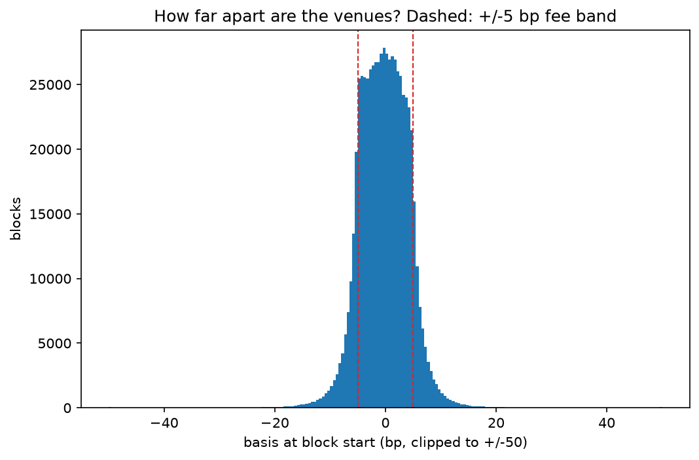

*Chart 2 shows how far the pool price at block start sits from Binance, with the ±5 bp fee band
dashed.* Quantiles of the basis in bp ([`results/basis.md`](results/basis.md), 659,799 blocks; mean
-0.2160; share of blocks outside the band 0.2171):

| | 1% | 5% | 25% | 50% | 75% | 95% | 99% |
|---|---|---|---|---|---|---|---|
| basis | -10.7436 | -6.6629 | -3.3110 | -0.2253 | 2.8524 | 6.2821 | 10.2110 |
| \|basis\| | 0.0592 | 0.2992 | 1.5131 | 3.0848 | 4.7604 | 8.0533 | 12.7623 |

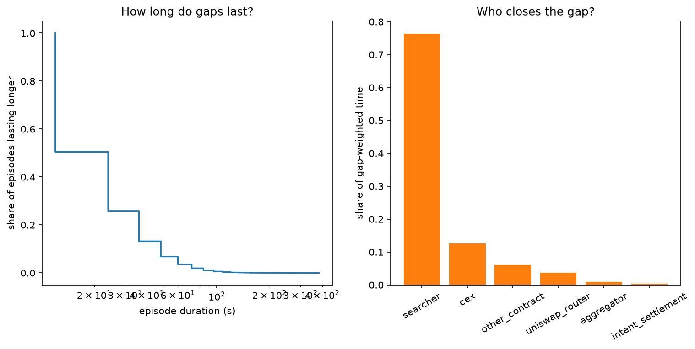

*Chart 3 shows how long gaps wider than 5 bp last (left) and who closes them, weighted by gap size
× time (right).* From [`results/episodes.md`](results/episodes.md):

| Closer | > 5 bp: episodes | share | gap-weighted share | median duration (s) | > 10 bp: episodes | share | gap-weighted share |
|---|---|---|---|---|---|---|---|
| searcher | 51,960 | 0.74 | 0.76 | 12.00 | 11,586 | 0.92 | 0.93 |
| cex (Binance moved back) | 10,345 | 0.15 | 0.13 | 12.00 | 313 | 0.02 | 0.02 |
| other_contract | 4,191 | 0.06 | 0.06 | 24.00 | 567 | 0.05 | 0.04 |
| uniswap_router | 2,902 | 0.04 | 0.04 | 24.00 | 100 | 0.01 | 0.01 |
| aggregator | 672 | 0.01 | 0.01 | 24.00 | 10 | 0.00 | 0.00 |
| intent_settlement | 220 | 0.00 | 0.00 | 24.00 | 7 | 0.00 | 0.00 |
| total | 70,290 | | | | 12,583 | | |

A one-block episode lasts 12 s, the shortest measurable, so the median gap that searchers close is
closed in the first block that can react.

### Lead-lag (chart 5)

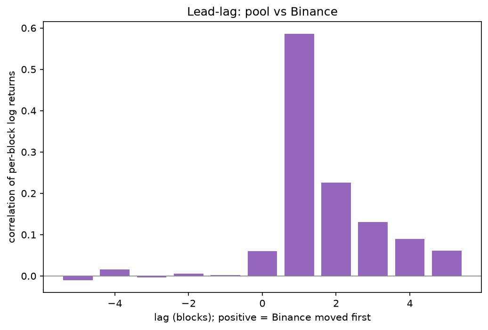

*Chart 5 shows the correlation of per-block pool and Binance log returns at lags -5 to +5 blocks;
positive lag = Binance moved first.* From [`results/leadlag.md`](results/leadlag.md): 0.0602 at
lag 0, 0.5860 at +1, 0.2260 at +2, 0.1301 at +3; at negative lags (pool first) it stays between
-0.0103 and 0.0153. AR(1) of the basis: φ = 0.6877, half-life 1.8517 blocks = 22.2203 s at the
median block interval of 12 s.

### Arbitrage: available, captured, kept (charts 4 and 6)

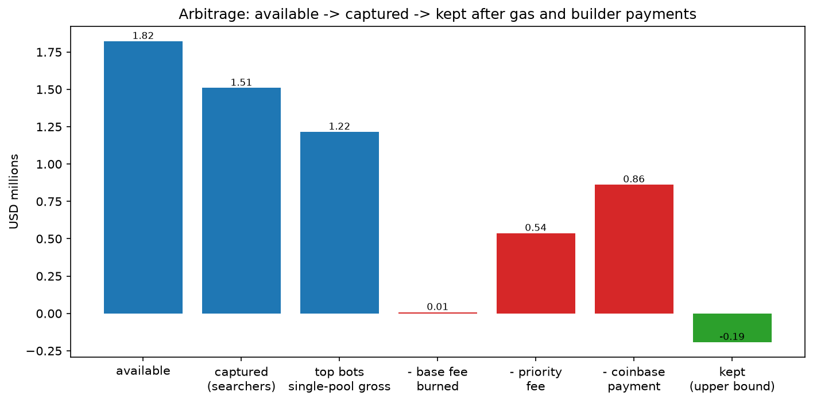

*Chart 4 shows the chain from the arbitrage available at block starts to what the top bots keep
after gas and builder payments, in USD millions.* From
[`results/arbitrage.md`](results/arbitrage.md):

| Step | USD millions |
|---|---|
| Available at block starts, no Binance fee | 1.82 |
| Available with a 1 bp Binance fee | 1.45 |
| Captured: all searchers' 0 s markouts | 1.51 |
| Top bots, single-pool transactions: gross | 1.22 |
| − base fee burned | 0.01 |
| − priority fees | 0.54 |
| − direct coinbase payments | 0.86 |
| = kept (upper bound) | -0.19 |
| Same costs against the 12 s markout: gross | 1.47 |
| = kept at 12 s (upper bound) | 0.06 |

Captured is 0.8281 of available, but it is not a subset of it: it also counts searchers trading
after other swaps in the same block and searcher strategies other than CEX-DEX arbitrage, and on
some days it exceeds available. Top bots, TOTAL row of
[`results/bot_profit.md`](results/bot_profit.md) (single-pool transactions; USD):

| Metric | TOTAL |
|---|---|
| swaps (one per transaction) | 88,002 |
| transactions with a coinbase payment | 56,724 |
| notional | 3,812,483,328.90 |
| gross (0 s markout) | 1,215,557.38 |
| gas burned | 7,828.33 |
| priority fees | 537,509.74 |
| coinbase payments | 862,314.01 |
| kept | -192,094.70 |
| builder income (priority + coinbase) | 1,399,823.75 |
| builder share of gross | 1.15 |
| multi-pool swaps (gross only, no cost split) | 22,987 |
| multi-pool gross | 324,841.08 |

Read "kept" with the caveats in the TL;DR: gross is the edge measured against Binance's last trade
at the block time, not the bots' realised hedge, and missed builder payments would lower "kept"
further (see [Limitations](#limitations)). Its sign depends on the horizon: kept is −$0.19M at the
0 s markout and +$0.06M at 12 s (builder income 115% vs 95% of gross; `kept_usd` and
`kept_12s_usd` in [`results/arbitrage.md`](results/arbitrage.md)).

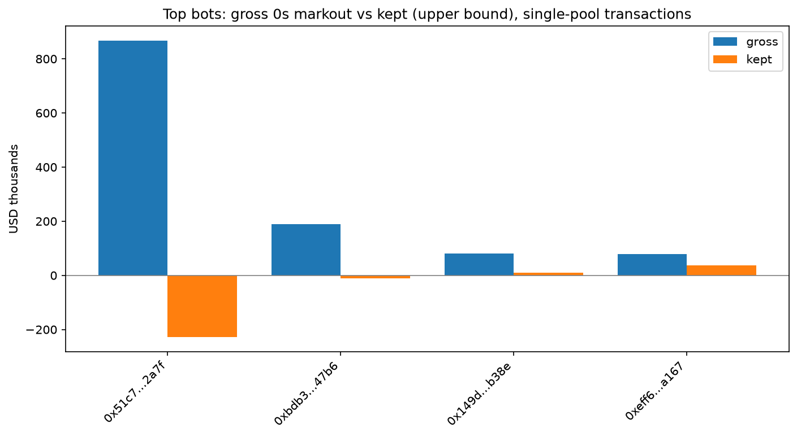

*Chart 6 shows gross and kept per top bot contract, single-pool transactions only.* The largest
bot pays builders 1.26 times its gross; the two smallest pay 0.89 and 0.52 times theirs and keep
8,867.73 and 38,004.34 USD.

## LP P&L

Everything in this section and the next is written by `uv run ulpe lp` into [`results/`](results/)
(headline numbers under `"lp"` in [`results/summary.json`](results/summary.json)), and only after
checks L1–L7 ([`results/lp_checks.md`](results/lp_checks.md)) pass. They are exact-integer
comparisons with the chain: all 534,377 swaps are reproduced bit-exactly step by step; the fee
accumulators equal the chain's at 500 random blocks (18,125 values); every open position's stored
liquidity, fee checkpoints and owed tokens equal the chain's at both ends of the window (12,263
compared); the positions open at the snapshot rebuild its tick book exactly; and for the 3,428
positions opened, closed and fully collected in the window, the engine's fees equal what they
collected minus the principal they withdrew, to the raw unit. Definitions:
[`docs/methodology.md`](docs/methodology.md), sections 9–17.

### Do fees cover LVR? (charts 7 to 9)

Window totals from [`results/lp_pnl.md`](results/lp_pnl.md), in USD:

| | USD |
|---|---|
| LP fees (after the protocol's quarter) | 2,644,187.17 |
| protocol fees | 881,290.13 |
| measured LVR, 0 s | 3,703,796.76 |
| measured LVR, 12 s | 4,089,325.49 |
| **LP fees − LVR (0 s)** | **−1,059,609.59** |
| LVR on searcher swaps / LP fees on searcher swaps | 4,144,118.00 / 1,976,144.85 |
| theoretical LVR, 1 s returns / 1-minute returns | 3,158,845.51 / 4,333,659.24 |
| theory, expected arbitrage profit (× P_trade) | 933,257.67 |
| theory, expected fees paid by arbitrage (× (1 − P_trade)) | 2,225,587.84 |

The LP fees are net of the protocol's quarter, which is most of the gap: total swap fees (LP +
protocol, summed from [`results/lvr_daily.csv`](results/lvr_daily.csv)) were 3,525,477.30, short of
LVR by 178,319.46. That matches sub-project 2's all-swaps markout of +0.25 bp (−0.14 to 0.77) at
0 s: the pool's counterparties as a whole roughly break even against Binance after the full fee.

Measured LVR is net over every swap: positive when the trade beat Binance, negative when the pool
did. Summed over a swap's steps it equals the sub-project 2 trader markout plus the swap fee, so on
each swap LP fees − LVR is the sub-project 2 LP markout at 0 s; check L6 confirms the identity
over the window to a relative 1e-9.

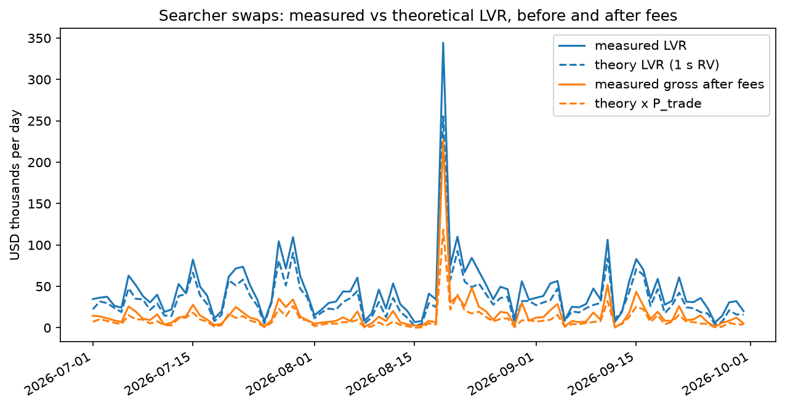

*Chart 8. Daily measured LVR on searcher swaps against the theoretical LVR from 1-second realised
variance (`RV × L × √P / 4`, the concentrated-liquidity form of σ²/8 × pool value), and the same
times P_trade, the probability that a block holds an arbitrage given the 0.05% fee and 12 s blocks
(Milionis, Moallemi, Roughgarden 2023, which supplies P_trade; the LVR formula is Milionis,
Moallemi, Roughgarden and Zhang 2022).* The formula tracks the measured series day by day but sits
below it on most days. With fees and discrete blocks the model expects arbitrageurs to earn $0.93M
gross and pay $2.23M in fees; measured, searchers' 0 s gross was $1.51M and they paid $1.98M in LP
fees plus $0.66M in protocol fees.

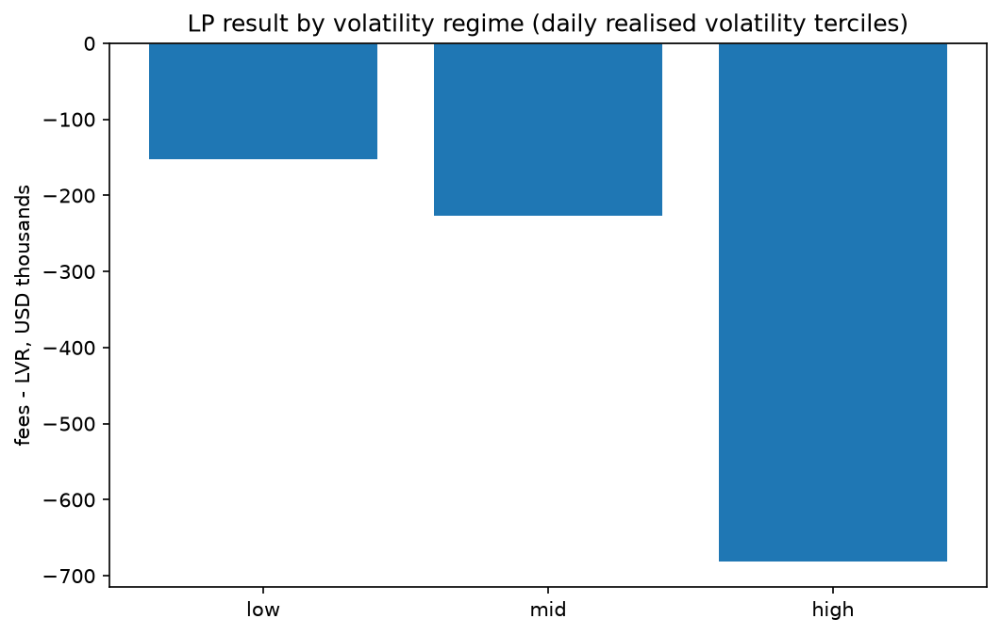

*Chart 9. Fees − LVR summed over the days of each tercile of daily realised volatility.* From
[`results/vol_regimes.md`](results/vol_regimes.md), USD:

| regime | days | mean σ, annualised | LP fees | LVR (0 s) | theory (1 s) | fees − LVR |
|---|---|---|---|---|---|---|
| low | 30 | 0.24 | 550,621.71 | 702,456.41 | 544,918.30 | -151,834.70 |
| mid | 31 | 0.39 | 842,277.63 | 1,068,876.83 | 911,278.11 | -226,599.20 |
| high | 31 | 0.57 | 1,251,287.82 | 1,932,463.52 | 1,702,649.11 | -681,175.69 |

Fees grow with volatility, but LVR grows faster. These are LP fees, net of the protocol's quarter.
With the protocol's fees added back (summed per regime from
[`results/lvr_daily.csv`](results/lvr_daily.csv)), total swap fees exceed LVR on the low and mid
terciles (+31,703.62 and +54,157.72) and fall short only on the high one (−264,180.80). The same
file splits each regime by LP type: JIT liquidity is positive in all three, wallet-held NFT
positions negative in all three.

### Which LPs make money? (chart 10)

Per window-active position: fees, LVR (0 s), gas of its own window transactions, P&L against a
portfolio that rebalances at Binance's price (`fees − LVR − gas`) and against holding the deposited
tokens, all in USD; the rate is that P&L in bp of the position's hourly time-weighted value per
day, with a 95% bootstrap interval over positions. From
[`results/lp_groups.md`](results/lp_groups.md) (one row per position in
[`results/positions.csv`](results/positions.csv)):

| grouping | group | positions | fees | LVR (0 s) | gas | P&L vs rebalancing | bp/day [95%] | P&L vs holding | share beating holding |
|---|---|---|---|---|---|---|---|---|---|
| LP type | jit | 844 | 4,752.92 | -28,934.84 | 19,771.41 | 13,916.34 | 5,629.54 [1,240.38, 10,381.09] | 13,916.34 | 0.57 |
| | lp_vault | 111 | 12,151.37 | 15,643.43 | 176.30 | -3,668.37 | -1.58 [-3.05, -1.21] | -20,529.53 | 0.32 |
| | nft_wallet | 5,788 | 2,572,025.84 | 3,644,992.64 | 5,495.25 | -1,078,462.06 | -1.35 [-1.77, -1.12] | -18,127,230.35 | 0.19 |
| | nft_contract | 734 | 38,156.22 | 50,739.87 | 1,717.36 | -14,301.02 | -2.28 [-2.77, -1.91] | -74,523.43 | 0.19 |
| | direct_other | 397 | 17,100.83 | 21,355.65 | 708.54 | -4,963.36 | -1.55 [-2.12, -1.08] | -198.55 | 0.38 |
| range width (bp) | <50 | 1,731 | 31,534.02 | 8,612.53 | 20,158.66 | 2,762.83 | 2.20 [-10.79, 20.75] | -7,993.98 | 0.36 |
| | 50-200 | 358 | 14,327.44 | 18,361.94 | 387.06 | -4,421.57 | -2.65 [-9.07, -0.90] | -5,679.83 | 0.19 |
| | 200-1000 | 1,158 | 114,084.67 | 148,283.46 | 1,893.20 | -36,092.00 | -2.44 [-5.04, -1.03] | -29,441.91 | 0.26 |
| | 1000-5000 | 2,496 | 1,909,750.05 | 2,755,449.25 | 3,682.81 | -849,382.01 | -1.73 [-3.04, -1.35] | -14,671,923.99 | 0.26 |
| | >=5000 | 2,131 | 574,490.99 | 773,089.57 | 1,747.13 | -200,345.71 | -0.67 [-0.75, -0.61] | -3,493,525.81 | 0.12 |
| holding in window | same_block | 844 | 4,752.92 | -28,934.84 | 19,771.41 | 13,916.34 | 5,629.54 [1,240.38, 10,381.09] | 13,916.34 | 0.57 |
| | <1h | 364 | 5,014.81 | 6,995.75 | 717.06 | -2,698.00 | -86.77 [-153.74, -42.83] | -7,658.74 | 0.11 |
| | 1h-1d | 982 | 47,377.64 | 91,490.69 | 1,708.17 | -45,821.22 | -34.44 [-67.84, -10.45] | -118,890.12 | 0.31 |
| | 1d-7d | 827 | 181,924.45 | 240,008.66 | 1,614.32 | -59,698.52 | -7.57 [-9.60, -3.87] | -33,331.51 | 0.32 |
| | >=7d | 1,784 | 1,074,902.86 | 1,453,936.54 | 3,738.48 | -382,772.16 | -2.27 [-2.87, -1.67] | -1,760,006.18 | 0.27 |
| | whole_window | 3,073 | 1,330,214.49 | 1,940,299.96 | 319.43 | -610,404.90 | -0.97 [-1.16, -0.64] | -16,302,595.32 | 0.10 |
| cohort | pre_window | 3,837 | 1,559,269.76 | 2,256,207.32 | 1,257.96 | -698,195.53 | -1.01 [-1.22, -0.73] | -17,415,498.80 | 0.09 |
| | in_window | 4,037 | 1,084,917.41 | 1,447,589.44 | 26,610.90 | -389,282.93 | -3.29 [-4.42, -2.34] | -793,066.73 | 0.38 |
| all positions | | 7,874 | | | | -1,087,478.46 | | -18,208,565.52 | 0.24 |

- **JIT** liquidity is added just before a swap and removed after it in the same block. Its LVR is
  negative: the flow it trades with loses to the pool against Binance. Most of its +$13.9k is that
  negative LVR (+28,934.84 to the LP), not fees (4,752.92), and gas (19,771.41) takes most of the
  rest. Its bp/day figure is large because a JIT position counts one 12 s slot of capital.
- **Every other type loses** against rebalancing, at 1.35 to 2.28 bp/day, with intervals below
  zero. Narrow ranges under 50 bp are the only width bucket with a positive point estimate
  (+2.20 bp/day), but its interval spans zero, and the bucket includes the JIT positions.
- **Shorter holdings lose more per day**: −86.77 bp/day for positions held under an hour,
  −0.97 bp/day for those open the whole window.
- **Against holding**, the totals are much larger (−$18.2M). That gap is the window's price path:
  the rebalancing portfolio's own result against holding, which is zero on average if price moves
  are unpredictable, but not on any one path. Fees − LVR is the part an LP who hedged at Binance's
  price would have kept.

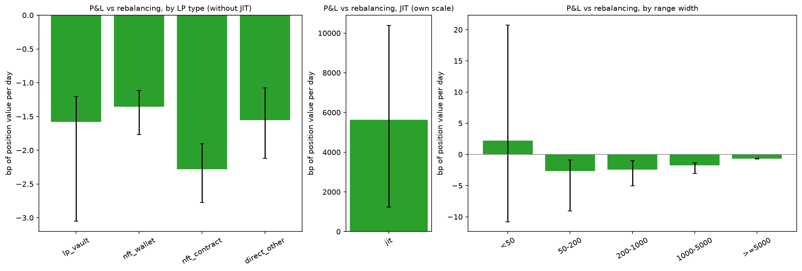

*Chart 10. P&L against rebalancing in bp of position value per day, by LP type (left) and range
width (right), with 95% bootstrap intervals. The JIT bar dwarfs the others on the left; their
values are in the table above.*

### Lifetime: did window-active positions beat holding? (chart 11)

Over their whole life, from the first deposit to the exit (or the window end), each window-active
position is compared with holding its deposits, valued at the exit price; the return divides by
the deposits valued at their own time (ETHUSDT 1-minute closes before the window). From
[`results/lifetime.md`](results/lifetime.md): 7,874 positions, none excluded for carried owed
tokens; **65.7% beat holding**, median return +0.03% (`summary.json`: 0.000330). Like the window
result against holding, these shares depend on the price path over each position's life, and so
on when it opened and closed.

| range width (bp) | positions | share beating holding | | lifetime | positions | share beating holding |
|---|---|---|---|---|---|---|
| <50 | 1,731 | 0.83 | | <1d | 2,167 | 0.67 |
| 50-200 | 358 | 0.48 | | 1-7d | 757 | 0.55 |
| 200-1000 | 1,158 | 0.50 | | 7-30d | 837 | 0.61 |
| 1000-5000 | 2,496 | 0.56 | | 30-180d | 1,166 | 0.40 |
| >=5000 | 2,131 | 0.75 | | >=180d | 2,947 | 0.79 |

The median return (a fraction of deposits) is 0.02 for ranges of 5,000 bp or more, 0.09 for
positions with a life of 180 days or more and −0.01 for lives of 30 to 180 days; elsewhere it
rounds to 0.00. Within the
window only 24.1% of positions beat holding; over a whole life the share is higher, but a share
counts positions, not dollars.

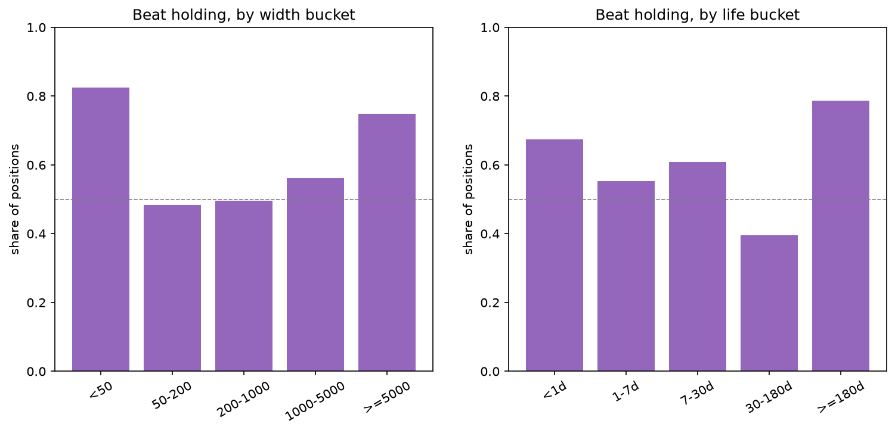

*Chart 11. Share of window-active positions whose lifetime result beat holding, by range width
(left) and lifetime (right); the dashed line is one half.*

## Where LVR goes

From [`results/lvr_destination.md`](results/lvr_destination.md), in USD and as shares of the LVR
on searcher swaps:

| Step | USD | share |
|---|---|---|
| pool LVR, 0 s | 3,703,796.76 | |
| − LVR on other flows (non-searcher) | -440,321.24 | |
| = LVR on searcher swaps | 4,144,118.00 | 1.0000 |
| → LP fees | 1,976,144.85 | 0.4769 |
| → protocol fees | 658,714.87 | 0.1590 |
| → searchers' gross (0 s markout) | 1,509,258.29 | |
| of which multi-pool transactions, gross only | 257,681.73 | 0.0622 |
| of which single-pool transactions | 1,251,576.57 | |
| → gas burned | 9,715.89 | 0.0023 |
| → builder margin | 654,139.41 | 0.1578 |
| → proposer payment | 789,291.15 | 0.1905 |
| → kept by searchers (upper bound) | -201,569.88 | -0.0486 |

- 253,280 searcher swaps, all of them costed: every one has an other-logs row, a block in the
  builder/proposer split and gas data.
- The searchers' gross equals sub-project 2's "captured" ($1.51M). Builder payments now come
  from traces, so they cover every searcher, not only the four top bots of sub-project 2.
- Searcher swaps carry more LVR than the whole pool (share 1.1189): the other flows trade at
  prices worse than Binance's and give part of it back.
- LPs recover about half of the searcher LVR as fees and the protocol about a sixth; most of the
  rest goes to the block's proposer and builder.
- **Why kept is negative.** Builder margin plus proposer payment (0.1578 + 0.1905 = 0.3483 of
  searcher LVR) is more than the single-pool gross at 0 s (1,251,576.57, 0.3020 of searcher LVR).
  Gross is measured at the block time against Binance's last trade, so this is a small difference
  of large totals, as in finding 3. Sub-project 2's positive kept at 12 s (+$0.06M) covers the
  top 4 bots only, not every searcher.
- Proposer payments are matched against relays on a sample: of 1,000 random blocks, 769 were found
  on a relay and 699 of those (90.9%) match the on-chain payment within 1 wei. That is just above
  the 90% below which the plan said to investigate the method. The other 70 (9.1%) differ by more
  than 1%, for a reason not established here.

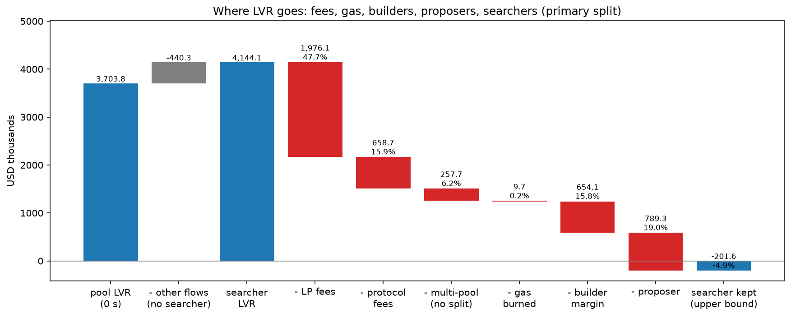

*Chart 12. From pool LVR at 0 s to LVR on searcher swaps, then to LP fees, protocol fees,
multi-pool gross, gas burned, builder margin, proposer payment and what searchers kept, in USD
thousands with shares of searcher LVR. Kept ends below zero because builder margin and proposer
payment together (34.8%) exceed the single-pool gross at 0 s (30.2%).*

> The split of builder payments between builder and proposer uses each block's ratio of proposer payment to builder revenue; how a builder prices an individual transaction is not observed. Proposer payments are identified as the block's last transaction from the fee recipient and cross-checked against relay data on a sample of blocks only.

## Limitations

### Price discovery and markouts (sub-project 2)

> Builder payments are detected only as direct ETH transfers from the bot contract to the block's fee recipient within the same transaction. Payments routed elsewhere (another contract, a separate transaction in the bundle, off-chain agreements) are missed, so the reported net profit is an **upper bound** on what the bots keep. Binance-side trading fees, inventory and hedging costs are not observed.

- **Reference = last Binance trade.** There is no order-book data for the window, so no mid price,
  and Binance is the only reference venue. 73,139 swaps have a 0 s reference older than 5 s; the
  robustness variant without them changes little.
- **t0 = block timestamp** (whole seconds, the start of the 12-second slot), while Binance trades
  carry sub-second timestamps and the bots' decision and hedge times are not observed. Short-horizon
  markouts depend on this choice (the searchers' 0 s edge is 1.80 bp with t0 − 2 s).
- **Available arbitrage ignores gas, Binance fees beyond the 1 bp sensitivity, and Binance depth.**
  It assumes the arbitrage is the first trade at the block-start state, and a gap that stays open is
  counted again at each block start, so it is not what one arbitrageur could have taken.
- **Labels are a curated list plus heuristics.** `searcher` is a structural pattern (the pool's
  caller is the transaction's target), not a verified identity, and 0.11 of notional stays
  `other_contract`; the two largest unlabelled addresses are unverified contracts with no public
  name tag.
- **Failed bot transactions are not counted.** A reverted transaction, or one that exits without
  trading, emits no Swap log in the pool, so its gas never enters the cost side. This is a further
  reason the bots' net profit is an upper bound.
- **Multi-pool bot transactions get no cost breakdown:** their costs also pay for trades in other
  pools, so they are reported gross only.
- **Builder income** is income of the block's fee recipient, usually the builder; what the builder
  passes on to the validator is not measured here (sub-project 3 splits it for searcher swaps, see
  [Where LVR goes](#where-lvr-goes)).
- **Statistics:** the bootstrap resamples UTC days and treats them as independent; for a thin group
  the interval is conditional on at least one active day and can be narrow.
- **Scope:** one pool and one quarter; nothing here is tested on other pools or periods.

### LP P&L and where LVR goes (sub-project 3)

> The split of builder payments between builder and proposer uses each block's ratio of proposer payment to builder revenue; how a builder prices an individual transaction is not observed. Proposer payments are identified as the block's last transaction from the fee recipient and cross-checked against relay data on a sample of blocks only.

- **Reference price.** Measured LVR, fees in USD and every P&L use Binance's last ETHUSDC trade, as
  above. Sub-project 4 tests a mid price and OKX.
- **Theory** assumes geometric Brownian motion and blocks arriving as a Poisson process, while
  Ethereum slots are a fixed 12 s; the 1-second realised variance of last trades includes
  order-flow noise. The 1-minute version gives about a third more LVR than the 1-second one.
- **LP hedging and other holdings are not observed.** P&L against rebalancing is what an LP who
  could rebalance for free at Binance's last trade would have made.
- **LP gas** is counted only for window transactions; gas before the window and in lifetime P&L
  is not.
- **Lifetime values before the window** use ETHUSDT 1-minute closes (quoted in USDT).
- **Who the LP is.** An NFT position's LP is its owner at close (570 window-active positions
  changed owner while open), and a vault stands for many depositors. Only four vault addresses are
  labelled (those Etherscan names as vaults); other managers stay `nft_contract` or
  `direct_other`. EIP-7702 delegated wallets count as wallets.
- **Small accounting edges, reported:** NFT collects keep the amounts the position manager
  requested, which can exceed what the pool paid by up to 48 raw USDC units or 44 wei (2,622
  collects in the pool's history); a direct position re-minted before its owed tokens were collected
  hands them to the next position, and such positions are left out of the lifetime statistics (none
  among the window-active positions).
- **Where LVR goes:** "kept" is an upper bound (builder payments outside the transaction and
  failed transactions are missed). The relay cross-check found 769 of 1,000 sampled blocks, and
  some relays were skipped after repeated time-outs. Of the 769, 70 (9.1%) disagree with the
  on-chain proposer payment by more than 1% for a reason not established; the 90.9% match rate
  only just clears the plan's 90% threshold for investigating the method.
- **Statistics:** the P&L intervals bootstrap positions and treat them as independent, though many
  positions share an LP.

## Reproduce

Requirements:

- Python 3.13 and [uv](https://docs.astral.sh/uv/).
- A `.env` (copy `.env.example`) with `ETH_RPC_URL` set to an **archive** Ethereum RPC, e.g. the
  Alchemy (the free tier worked for us as of Oct 2026). Keep it private: the URL contains your API
  key. The code never prints or logs the RPC URL; server-supplied error messages are passed through.
- `gcloud auth application-default login` for BigQuery, and `GCP_PROJECT` in `.env` set to your
  project. The free sandbox was enough for sub-projects 1 and 2 (as of Oct 2026); the paid queries
  of sub-project 3 need billing linked to the project.

```bash
uv sync
uv run pytest -q                  # offline; includes the real-data fixture test
uv run ulpe all --confirm-cost    # the whole pipeline: fetch anything missing, build, validate, analyze, lp
```

**Cost.** Sub-project 3 runs two sets of paid BigQuery queries, once each. The position history
scans about 3 TB (dry run 2.98 TB) and is billed once: its first stage writes a BigQuery table that a
re-run reuses for 7 days, and the downloaded files are skipped afterwards. The three builder
queries scan about 0.66 TB in total. A Google Cloud free-trial credit covered both for us. Without
`--confirm-cost`, `ulpe all` issues no billable BigQuery query: it runs every step whose data is
already on disk, and stops with a message at the first BigQuery step whose output is missing
(pool logs, blocks, history or builder tables). `ulpe fetch-history` on its own also refuses to
query without `--confirm-cost`; it first prints the size from a free dry run.

`uv run pytest` needs no network or credentials: tests that touch the network are marked `live` and
skipped by default. The fixture test replays the first 400 real pool events of the window against a
matching slice of the on-chain tick book and runs checks C1 and C2 on them. An end-to-end test runs
the whole analysis (checks A1–A6, every table and chart) on the same events, with synthetic Binance
prices and bot data, and another runs `ulpe lp`'s analysis (checks L1–L7, charts 7–12) on a small
synthetic pool with a position opened before the window, an NFT position, a JIT position and a
flash loan.

`ulpe all` can also be run one step at a time, in the order below. Each fetch step skips what is
already on disk. The data foundation:

```bash
uv run ulpe fetch-logs --start 2026-07-01 --end 2026-10-01   # BigQuery pool logs (--dry-run reports bytes scanned)
uv run ulpe fetch-snapshot                                   # tick book at the snapshot block (RPC)
uv run ulpe fetch-samples                                    # on-chain state at 500 random blocks (RPC)
uv run ulpe fetch-cex                                        # Binance ETHUSDC trades and ETHUSDT 1s candles
uv run ulpe build                                            # raw files -> interim tables
uv run ulpe validate                                         # checks C1-C6, writes data_validation/validation_report.{md,json}
```

`validate` (and `all`) exit non-zero if any check fails. Downloaded and built data goes under
`DATA_DIR` (default `./data`) and is git-ignored.

Price discovery and markouts (sub-project 2):

```bash
uv run ulpe fetch-blocks      # BigQuery: block fee recipients and base fees; logs in top-bot transactions
uv run ulpe fetch-transfers   # Alchemy: internal ETH transfers sent by the top bot contracts
uv run ulpe analyze           # checks A1-A6, then results/: tables, charts, summary.json
```

`fetch-blocks` takes `--dry-run` to report bytes scanned. `fetch-transfers` calls
`alchemy_getAssetTransfers`, so for that step `ETH_RPC_URL` must be an Alchemy endpoint; it caches
one file per bot contract and skips contracts already fetched. `analyze` refuses to run unless
validation passed on exactly the interim files now on disk; if a gated check (A1–A4) fails it exits
non-zero and writes no results. Its per-swap and per-block working tables go to
`DATA_DIR/processed` (git-ignored).

LP P&L and where LVR goes (sub-project 3):

```bash
uv run ulpe fetch-chain-state                  # RPC: fee state at the snapshot and the 500 sample blocks
uv run ulpe fetch-history --dry-run            # free: prints the size of the paid history query
uv run ulpe fetch-history --confirm-cost       # BigQuery, paid: pool and position-manager history since 2021
uv run ulpe fetch-chain-state                  # again: position state at both ends of the window, LP code (RPC)
uv run ulpe fetch-price-history                # Binance ETHUSDT 1-minute candles since 2021
uv run ulpe fetch-builders                     # BigQuery, paid: builder revenue and payments (--dry-run reports bytes)
uv run ulpe fetch-relays                       # relay data APIs: proposer payments for 1,000 sampled blocks
uv run ulpe lp                                 # checks L1-L7, then results/: tables, charts 7-12, summary.json["lp"]
```

`fetch-chain-state` runs twice because its position part needs the history. `fetch-builders` stops
before querying if a dry run exceeds its 700 GB cap. `fetch-relays` is resumable and skips a relay
after three consecutive failed blocks. `lp` refuses to run unless validation passed on the interim
files on disk and the `analyze` outputs exist; if a check L1–L7 fails it writes the checks file
and no results.

## Repo map

```
src/uniswap_lp_economics/
  abi.py            keccak, event topics and 32-byte word encoding
  config.py         pool constants, study window and settings from .env
  events.py         decode raw pool logs into typed values
  v3math.py         Uniswap V3 tick/price math and USDC/WETH price conversions
  tickbook.py       replayable per-tick liquidity state and active liquidity
  rpc.py            JSON-RPC client with retries, Multicall3 batching, pool call codecs
  snapshot.py       read the tick book and sampled state from chain
  io.py             parquet read/write for exact integers (Int128 in memory, Decimal(38,0) on disk)
  data/
    bigquery.py     download pool logs from BigQuery, one file per month
    binance.py      checksum-verified Binance downloads and parsing
    blocks.py       block fee recipients and base fees, and logs in top-bot transactions (BigQuery)
    transfers.py    top-bot internal ETH transfers (Alchemy), one cached file per contract
    history.py      pool and position-manager history since 2021: one paid, two-stage BigQuery fetch
    chain_state.py  fee and position state at the snapshot, sample and end blocks; LP code (RPC)
    builders.py     builder revenue, proposer payment and per-transaction payments (BigQuery aggregates)
    relays.py       relay-reported proposer payments for a block sample, with a circuit breaker
  build.py          raw downloads -> interim tables (events, swaps, CEX prices)
  validate.py       checks C1-C6 and the validation report
  replay.py         public event replay: pool state after every event and at every block start
  v3swap.py         exact-integer V3 swap simulation and optimal arbitrage against a CEX price
  flows.py          flow labels from labels/addresses.csv, size buckets, top-bot selection
  align.py          as-of Binance reference prices and their age at each markout horizon
  markouts.py       per-swap markouts, grouped tables, day bootstrap, stale-reference filter
  arbprofit.py      gas, priority fees and coinbase payments per swap; gross vs kept per top bot
  discovery.py      per-block series, basis, gap episodes, lead-lag, AR(1), available arbitrage
  checks.py         analysis checks A1-A6
  report.py         results tables (CSV and markdown), summary.json, the limitation text
  figures.py        the six charts in results/figures (matplotlib, Agg backend)
  analyze.py        `ulpe analyze`: validated data -> checks -> results/
  lp/               sub-project 3: LP P&L and where LVR goes
    swapfees.py     exact per-swap LP and protocol fees from the step-by-step re-simulation
    state.py        fee-growth accumulators as the contract keeps them, plus USD-fee and LVR accumulators
    positions.py    positions from the full history: NFT matching, direct-key episodes, LPs
    engine.py       window replay: every swap step and liquidity event through the accumulators
    ledger.py       contract mirror (what the chain stores) and attribution per position
    pnl.py          window P&L per position and by group, gas, time-weighted value, bootstrap
    theory.py       theoretical LVR, P_trade, volatility regimes
    lifetime.py     lifetime P&L against holding
    destination.py  where LVR goes: fees, gas, builder margin, proposer payment, kept
    checks.py       checks L1-L7 and the reported checks R1-R5
    figures.py      charts 7-12
    analyze.py      `ulpe lp`: validated data -> checks -> results/ and summary.json["lp"]
  cli.py            `ulpe` command-line entry point (`ulpe all` runs every step in order)
scripts/
  make_fixture.py   cut the small real-data test fixture
  migrate_int128_to_decimal.py   one-off: convert early raw files from Int128 to Decimal(38,0)
tests/              unit tests, the real-data fixture test and the end-to-end analysis test
  fixtures/         real pool events and tick book for the offline fixture test
labels/             curated address labels (addresses.csv) and LP vaults (lp_addresses.csv), with a source link per address
results/            committed results: tables (.md, .csv), figures/, summary.json, analysis and LP checks
data_validation/    committed validation report (.md and .json)
docs/methodology.md every definition and formula behind results/
docs/superpowers/   design specs and implementation plans for sub-projects 1 to 3
```

## Further reading

- Milionis, Moallemi, Roughgarden, Zhang (2022), *Automated Market Making and Loss-Versus-Rebalancing*.
- Milionis, Moallemi, Roughgarden (2023), *Automated Market Making and Arbitrage Profits in the
  Presence of Fees*, arXiv:2305.14604 (the `P_trade` adjustment).
- Adams et al. (2021), *Uniswap v3 Core* whitepaper.

## License and disclaimer

MIT. Research only; not financial advice.
