# uniswap-lp-economics

**Who makes money on Uniswap V3?** A swap-by-swap study of the USDC/WETH 0.05% pool on Ethereum
mainnet against Binance: how fast the pool follows the CEX price, who closes the gaps, what each
flow type earns or loses (markouts), and what arbitrage bots keep after gas and builder payments.
Then the liquidity providers' side: whether LP fees cover loss-versus-rebalancing (LVR), which LPs
make money, and where the LVR goes.

[](https://github.com/samuraixx-key/uniswap-lp-economics/actions/workflows/ci.yml)


> **Status:** sub-projects 1 (data foundation), 2 (price discovery and markouts), 3 (LP P&L and
> where LVR goes) and 4 (reference and timing robustness) are complete; data checks C1–C6 and the
> gated analysis and LP checks (A1–A4, L1–L7) all pass. Proposer-payment detection is done: its
> first pre-registered test kept a two-sided proposer/builder split, and a second one, with a
> recipient check that follows forwarding contracts, passed, so one split is reported. Phase 5
> (strategy experiment), the fifth sub-project, is done: a pre-registered test of counterfactual
> LP strategies, gated by checks S1–S2. Next: the open items in the
> [roadmap](docs/roadmap.md), then the report (Phase 6).

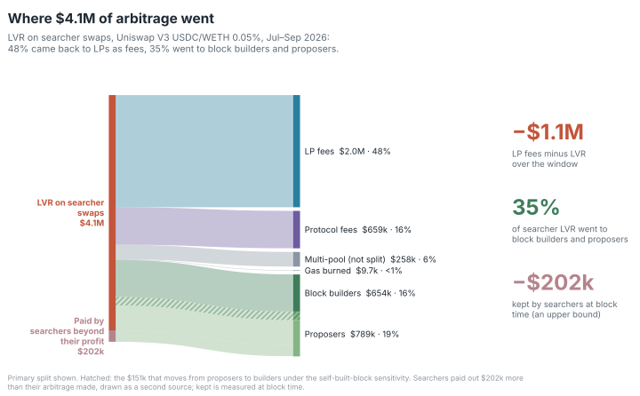

## TL;DR

**Question.** In the USDC/WETH 0.05% pool from 2026-07-01 to 2026-10-01 (534,377 swaps, $7.05B
notional), which flow wins against the pool and which loses to it, measured against Binance? How
quickly does the pool follow Binance? And how much of the arbitrage edge do the bots keep after gas
and payments to block builders?

1. **Searchers win against the pool; flow through Uniswap's routers loses the most.** Trader
   markout at the block time (0 s) against Binance, notional-weighted, after the 0.05% swap fee:
   searchers (contracts that call the pool directly from transactions sent to them, typically
   bots; 75% of notional) **+2.86 bp** (95% day-bootstrap interval 2.38 to 3.50), +3.58 bp at
   12 s, while the median searcher swap is -0.57 bp (the notional-weighted mean is carried by larger
   swaps); Uniswap-router flow **-10.66 bp** (-11.28 to -10.01); aggregators -6.76 bp; other
   contracts -4.35 bp.
   *Caveat:* the reference is Binance's last trade at the block timestamp, and the searchers' 0 s
   edge moves with that choice (1.80 bp with t0 − 2 s, 3.34 bp against ETHUSDT). Every label keeps
   its sign in all four variants up to 5 minutes; at 1 h the intervals widen a lot. Markouts include
   the fee and each swap's own price impact, so uninformed flow is negative by construction.
2. **Binance leads; the pool follows in the next block.** Per-block returns correlate most at lag
   +1 block (0.59, against 0.06 at lag 0): the pool's move in a block tracks Binance's move in the
   12 s before it. The median absolute gap between the pool at block start and Binance is 3.08 bp;
   21.7% of blocks start outside the ±5 bp fee band; an AR(1) fit gives a half-life of 1.85 blocks
   (about 22 s). Searchers close 74% of the 70,290 gaps wider than 5 bp, and 92% of the 12,583
   wider than 10 bp.
   *Caveat:* all of this is at block resolution (12 s) against Binance's last trade, so it shows
   the pool updating at the first block that can react, not who discovers the price within a
   block; the AR(1) fits one decay rate to blocks inside and outside the band.
3. **Builders receive roughly all of the edge that is measurable at block time.** Arbitrage
   available at block starts (before gas, no Binance fee): $1.82M ($1.45M with a 1 bp Binance fee).
   Searchers' 0 s markouts total $1.51M. The four top bot contracts' single-pool transactions made
   $1.22M gross at 0 s and paid $1.40M to block builders (priority fees $0.54M, direct coinbase
   payments $0.86M; base fee burned $7.8k): builder income is 115% of gross, and "kept" is
   -$0.19M.
   *Caveat:* this does not mean the bots lose money. "Kept" is a small difference of large totals
   and its sign depends on the horizon: with the same costs, kept is −$0.19M at the 0 s markout and
   +$0.06M at 12 s (builder income 115% vs 95% of gross). Gross is measured against Binance's last
   trade at the block timestamp; the bots' own hedge price and timing are not observed, and the edge
   depends on t0 (searchers: 1.80 bp at t0 − 2 s, 2.86 bp at t0, 3.58 bp at 12 s). Binance-side
   fees, inventory and hedging are not observed either. Builder payments routed elsewhere are
   missed, which would make "kept" lower still: that is what "upper bound" means in the
   [limitation](#limitations).

**And for the liquidity providers.** Do the fees they earn cover LVR (what they lose by trading
at the pool's price instead of Binance's)? Which LPs make money? And where does the LVR go?

4. **LPs' fees, after the protocol's quarter, do not cover LVR.** Over the window LPs earned
   **$2.64M** in fees net of the protocol's quarter (which took $0.88M) and lost **$3.70M** to LVR
   measured at the block time ($4.09M at 12 s): LP fees − LVR = **−$1.06M** (95% day-bootstrap
   interval −$1.53M to −$0.71M). LP fees fell short in
   every volatility tercile of days: −$0.15M on the 30 calmest days, −$0.23M on the middle 31 and
   −$0.68M on the 31 most volatile. The LVR formula of Milionis, Moallemi, Roughgarden and Zhang
   (2022), with 1-second Binance returns, gives $3.16M.
   *Caveat:* the protocol's quarter is most of the gap. Before it, total swap fees ($3.53M) fell
   short of LVR by only $0.18M (interval −$0.57M to +$0.09M, which spans zero), and all of that on
   the most volatile third of days (−$264k); on the
   calm and middle thirds total fees exceeded LVR (+$31.7k and +$54.2k), and LVR exceeded total
   fees on 41 of the 92 days. That matches sub-project 2's all-swaps markout of +0.25 bp
   (−0.14 to 0.77): the pool's counterparties as a whole roughly break even after the full fee.
   LVR here is measured swap by swap against Binance's last trade at the block time, net of all
   flow: searcher swaps alone cost LPs $4.14M, and the rest of the flow gave $0.44M back. It is the
   loss against a portfolio that rebalances at Binance's price, not a loss against holding. The
   theoretical value depends on sampling: 1-minute returns give $4.33M. Other references and read
   times ([Is it the reference price?](#is-it-the-reference-price)): a trade-side mid proxy gives
   −$0.92M, ETHUSDT −$1.10M, and the median winning-bid time (+1.0 s) −$1.31M; the result turns
   positive only if prices are read more than 3 s before the slot.
5. **No LP type reliably makes money against a rebalancing portfolio.** Against a portfolio that
   rebalances at Binance's price, after gas and direct payments to block builders, the 7,874
   positions active in the window lost **$1.10M**. Just-in-time (JIT) positions (844, minted and
   burned in the same block) are the only type with a positive total, +$3.6k, and its 95% interval
   spans zero. It comes from negative LVR, not fees: the flow they trade with loses to the pool
   against Binance, which adds $28.9k, against $4.8k of fees, $19.8k of gas and $10.4k of direct
   builder payments. Every other LP type lost between 1.35 and
   2.28 bp of position value per day, each with a 95% interval below zero: NFT positions held by
   wallets, which earned $2.57M of the $2.64M in fees, **−1.35 bp/day** (−1.77 to −1.12) and
   −$1.08M; vaults −1.58; NFT positions held by contracts −2.28; other direct positions −1.55.
   Against simply holding the deposited tokens, 24.1% of positions came out ahead within the
   window; over their whole life, 53.5% did (median return about zero), and 78% of positions with
   a life of 180 days or more.
   *Caveat:* 265 of the 1,662 JIT transactions also swap in the pool, and they carry
   99.5% of JIT's direct builder payments, which may be for the swap rather than the
   liquidity. Their 298 swaps
   lost $14.3k against Binance at 0 s, which the rebalancing benchmark takes as free; counted with
   those swaps, the JIT operators lost about $10.7k. The benchmark assumes the LP could hedge for
   free at Binance's last trade; LPs' hedges and other holdings are not observed. Gas and builder
   payments are charged inside the window only, in the window and the lifetime results alike. The
   window result against holding (−$18.2M) is mostly the window's price path, not LVR. The lifetime
   results (53.5%, and 78% for lives of 180 days or more) depend in the same way on the price path
   over each position's own life, and so on when it opened and closed. Lifetime shares count
   positions, not dollars, and value deposits made before the window at ETHUSDT 1-minute closes.
   A vault stands for many depositors, and an NFT position's LP is its owner at close.
6. **Where LVR goes: back to LPs as fees, then to block builders and proposers; searchers keep
   nothing measurable at block time.** Of the $4.14M of LVR on searcher swaps, 47.7% went to LPs as
   fees, 15.9% to the protocol and **34.8% to builders and proposers together**; 6.2% is the gross
   of multi-pool transactions (not split), 0.2% gas burned, and the searchers kept **−4.9%**
   (−$0.20M). Of the 34.8%, **14.4% went to proposers and 20.5% to builders**. The split comes from
   measured payments (each block's last transaction, sent by the fee recipient or by a payout
   address learned from chain data), tested on two blind relay holdouts: every holdout block of
   the payout rule found on a relay matches its payment to the wei (289 of 289, then 290 of 290).
   The first test's check of *who* was paid failed, because about half of all payments pass through
   one forwarding contract; a check that follows the contract, written down before a second holdout
   was drawn, passed 290 of 290, so this split replaces the earlier two-sided one (see
   [Where LVR goes](#where-lvr-goes)). The 34.8%, gas and kept do not depend on the split. Kept is
   negative because the 34.8% exceeds the single-pool gross at 0 s (30.2% of searcher LVR). It is
   an upper bound (payments outside the transaction are missed) and, as in finding 3, a small
   difference of large totals measured at the block time; sub-project 2's positive kept at 12 s
   covers the top 4 bots only.

**And can an LP do better?** Rules fixed on July 2026 data, results reported on August–September
(61 days), every number a counterfactual.

7. **The range test is inconclusive, the fee test was not run, and a hedge changes the risk, not
   the gap.** Of 27 re-centring strategies at $1M, the only three small enough to be
   price-takers (ranges of ±5,000 bp) keep fees ÷ LVR within the pre-registered ±0.068 of full
   range; the other 24 hold more than 5% of the pool's active liquidity at their peak, and the
   verdict, **inconclusive**, depends on them. Re-centring a ±10 bp range each time the price
   leaves it returns **−454 bp/day** of capital, against −0.19 for full range (counterfactual:
   ignores how other traders would react to a different range). In the fee model LPs break even
   at about **8.6 bp**, and at that fee the pool can lose at most **43%** of its other volume
   before LPs are no better off than at 5 bp (model-only, because the model failed its July
   calibration; counterfactual at constant volume: ignores how traders would react to a higher
   fee). An hourly perpetual hedge cuts the spread of a full-range position's daily P&L from
   **$16.4k to $160** per $1M (counterfactual: ignores how other traders would react) and leaves
   fees − LVR unchanged, since that is already measured against the hedged LP.
   *Caveat:* August–September is out of sample for every parameter, not for the analyst: the
   window's aggregate results were known when the hypothesis was written. The protocol's cut is
   still the largest single number: with no cut, full range's fees ÷ LVR over August–September
   would be 1.01 (arithmetic, no model). See [Can an LP do better?](#can-an-lp-do-better).

## Contents

- [What is LVR?](#what-is-lvr) · [Does the pool follow Binance?](#does-the-pool-follow-binance) · [Who wins against the pool?](#who-wins-against-the-pool)
- [How big is LVR, and when?](#how-big-is-lvr-and-when) · [Do arbitrage bots keep the edge?](#do-arbitrage-bots-keep-the-edge) · [Who pays?](#who-pays) · [Where LVR goes](#where-lvr-goes)
- [Is it the reference price?](#is-it-the-reference-price) · [Can an LP do better?](#can-an-lp-do-better) · [Data](#data) · [Method](#method) · [Limitations](#limitations) · [Reproduce](#reproduce) · [Repo map](#repo-map) · [Further reading](#further-reading) · [Roadmap](docs/roadmap.md)

## What is LVR?

Loss-versus-rebalancing (LVR) is what an LP loses because the pool's price can only move when a block lands, while Binance moves continuously. Each move opens a gap; the next block's arbitrageur trades the pool back to Binance's price, and the LP is on the losing side of that trade.

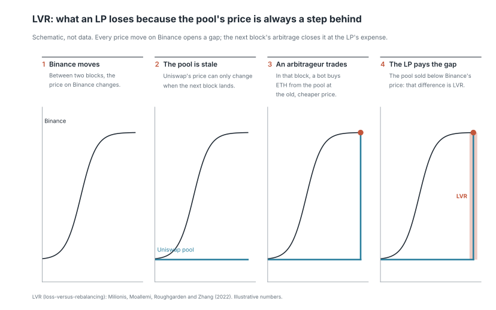

A real episode, picked by a fixed rule (the 20 blocks with the largest Binance move on the day with the most LVR; see [`docs/methodology.md`](docs/methodology.md), Figures):

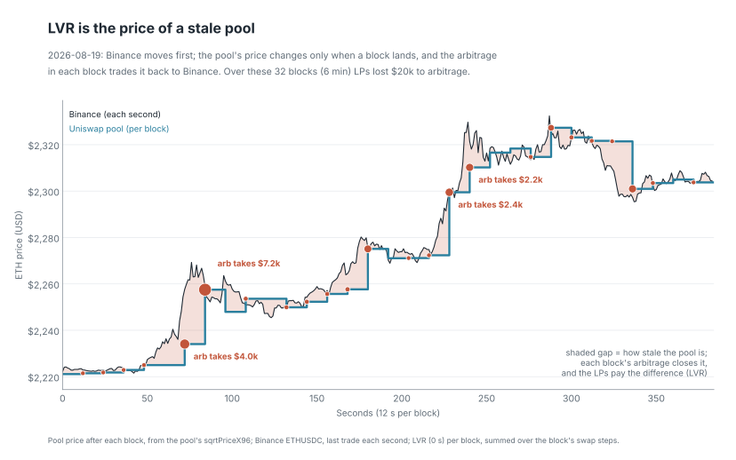

Animated, block by block: [`results/figures/02_stale_pool_episode.gif`](results/figures/02_stale_pool_episode.gif).

## Does the pool follow Binance?

The price-discovery, markout and arbitrage results (this chapter, [Who wins against the
pool?](#who-wins-against-the-pool) and [Do arbitrage bots keep the
edge?](#do-arbitrage-bots-keep-the-edge)) are written by `uv run ulpe analyze` into
[`results/`](results/) (headline numbers
in [`results/summary.json`](results/summary.json)), and only after checks A1–A6
([`results/analysis_checks.md`](results/analysis_checks.md)) pass: every historical swap is
re-simulated within tolerance (A1 replays each swap as exact input only, which reproduces 496,936
of 534,377 bit-exactly; sub-project 3's check L1 adds the exact-output and to-price modes and
reproduces all 534,377, see [How big is LVR, and when?](#how-big-is-lvr-and-when)), the block series is complete
(659,799 blocks), and trader + LP + protocol markouts sum to zero on every swap (largest residual
about 2e-11 USD).

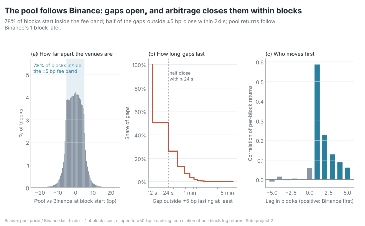

### Basis and gap episodes

Quantiles of the basis in bp ([`results/basis.md`](results/basis.md), 659,799 blocks; mean
-0.2160; share of blocks outside the band 0.2171):

| | 1% | 5% | 25% | 50% | 75% | 95% | 99% |
|---|---|---|---|---|---|---|---|
| basis | -10.7436 | -6.6629 | -3.3110 | -0.2253 | 2.8524 | 6.2821 | 10.2110 |
| \|basis\| | 0.0592 | 0.2992 | 1.5131 | 3.0848 | 4.7604 | 8.0533 | 12.7623 |

Who closes gaps wider than 5 and 10 bp, weighted by gap size × time, from [`results/episodes.md`](results/episodes.md):

| Closer | > 5 bp: episodes | share | gap-weighted share | median duration (s) | > 10 bp: episodes | share | gap-weighted share |
|---|---|---|---|---|---|---|---|
| searcher | 51,960 | 0.74 | 0.76 | 12.00 | 11,586 | 0.92 | 0.93 |
| cex (Binance moved back) | 10,345 | 0.15 | 0.13 | 12.00 | 313 | 0.02 | 0.02 |
| other_contract | 4,191 | 0.06 | 0.06 | 24.00 | 567 | 0.05 | 0.04 |
| uniswap_router | 2,902 | 0.04 | 0.04 | 24.00 | 100 | 0.01 | 0.01 |
| aggregator | 672 | 0.01 | 0.01 | 24.00 | 10 | 0.00 | 0.00 |
| intent_settlement | 220 | 0.00 | 0.00 | 24.00 | 7 | 0.00 | 0.00 |
| total | 70,290 | | | | 12,583 | | |

A one-block episode lasts 12 s, the shortest measurable, so the median gap that searchers close is
closed in the first block that can react.

### Lead-lag

Correlation of per-block pool and Binance log returns at lags −5 to +5 blocks (positive lag =
Binance moved first), from [`results/leadlag.md`](results/leadlag.md): 0.0602 at
lag 0, 0.5860 at +1, 0.2260 at +2, 0.1301 at +3; at negative lags (pool first) it stays between
-0.0103 and 0.0153. AR(1) of the basis: φ = 0.6877, half-life 1.8517 blocks = 22.2203 s at the
median block interval of 12 s.

## Who wins against the pool?

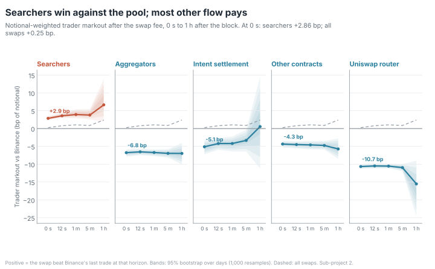

Mean trader markout in bp of notional, with the 95% day-bootstrap interval, from
[`results/markouts.md`](results/markouts.md) (swap counts at 0 s; notional share from
[`results/labels_coverage.md`](results/labels_coverage.md), which rounds intent settlement's 0.005
to 0.00; the unrounded share is in `summary.json`, `label_coverage`):

| Flow label | Swaps | Notional share | 0 s | 12 s | 60 s | 300 s | 3,600 s |
|---|---|---|---|---|---|---|---|
| searcher | 253,280 | 0.75 | 2.86 [2.38, 3.50] | 3.58 [2.97, 4.41] | 3.93 [2.88, 5.45] | 3.78 [2.56, 5.46] | 6.65 [1.93, 13.88] |
| uniswap_router | 167,988 | 0.12 | -10.66 [-11.28, -10.01] | -10.49 [-11.18, -9.77] | -10.53 [-11.21, -9.83] | -10.95 [-11.93, -9.96] | -15.53 [-24.62, -9.01] |
| other_contract | 91,722 | 0.11 | -4.35 [-5.29, -3.46] | -4.50 [-5.57, -3.57] | -4.58 [-5.87, -3.50] | -4.74 [-5.91, -3.47] | -5.72 [-8.54, -2.77] |
| aggregator | 17,822 | 0.02 | -6.76 [-7.89, -5.85] | -6.54 [-7.49, -5.71] | -6.72 [-7.76, -5.85] | -6.96 [-8.18, -5.77] | -6.98 [-10.07, -4.03] |
| intent_settlement | 3,565 | 0.005 | -5.11 [-7.25, -3.25] | -4.21 [-5.98, -2.62] | -4.19 [-6.43, -2.23] | -3.33 [-6.45, -0.35] | 0.55 [-11.20, 14.49] |
| all swaps | 534,377 | | 0.25 [-0.14, 0.77] | 0.80 [0.30, 1.48] | 1.04 [0.26, 2.20] | 0.87 [0.03, 2.06] | 2.39 [-0.72, 7.69] |

- **Size matters** (`flow_label_x_size` rows, 0 s). Searcher swaps of $100k or more: +6.20 bp
  [4.98, 7.52]; searcher swaps under $1k: -4.38 bp. Uniswap-router swaps of $100k or more:
  -17.16 bp [-18.24, -16.07], which includes their own price impact.
- **All swaps together:** +0.25 bp at 0 s [-0.14, 0.77] and +0.80 bp at 12 s [0.30, 1.48]. After
  fees, the pool's counterparties as a whole roughly break even against Binance at the block time
  and win slightly 12 s later; the searchers' gains are largely offset by the other flow's losses.
  LP P&L proper (fees vs LVR, net of the protocol's quarter) is in
  [How big is LVR, and when?](#how-big-is-lvr-and-when).
- **Robustness** ([`results/markouts_robustness.md`](results/markouts_robustness.md)), mean bp at
  0 s:

  | Flow label | primary | ETHUSDT reference | t0 − 2 s | excluding references > 5 s old |
  |---|---|---|---|---|
  | searcher | 2.86 | 3.34 | 1.80 | 2.94 |
  | uniswap_router | -10.66 | -12.83 | -10.71 | -10.78 |
  | other_contract | -4.35 | -4.56 | -4.49 | -4.19 |
  | aggregator | -6.76 | -7.79 | -6.72 | -6.84 |
  | intent_settlement | -5.11 | -5.66 | -5.07 | -5.32 |

  In every variant, every label's interval excludes zero at every horizon, except intent settlement
  at 1 h, whose sign also flips in one variant. The ETHUSDT column also carries the USDT/USDC rate,
  so part of its difference from the primary column is the quote currency, not the reference
  timing. Moving t0 back 2 s lowers the searchers' 0 s edge
  from 2.86 to 1.80 bp but leaves 12 s almost unchanged (3.57 against 3.58).

## How big is LVR, and when?

The LVR and LP results (this chapter, [Who pays?](#who-pays) and [Where LVR goes](#where-lvr-goes))
are written by `uv run ulpe lp` into [`results/`](results/)
(headline numbers under `"lp"` in [`results/summary.json`](results/summary.json)), and only after
checks L1–L7 ([`results/lp_checks.md`](results/lp_checks.md)) pass. They are exact-integer
comparisons with the chain: all 534,377 swaps are reproduced bit-exactly step by step; the fee
accumulators equal the chain's at 500 random blocks (18,125 values); every open position's stored
liquidity, fee checkpoints and owed tokens equal the chain's at both ends of the window (12,263
compared); the positions open at the snapshot rebuild its tick book exactly; and for the 3,428
positions opened, closed and fully collected in the window, the engine's fees equal what they
collected minus the principal they withdrew, to the raw unit. Definitions:
[`docs/methodology.md`](docs/methodology.md), sections 9–17.

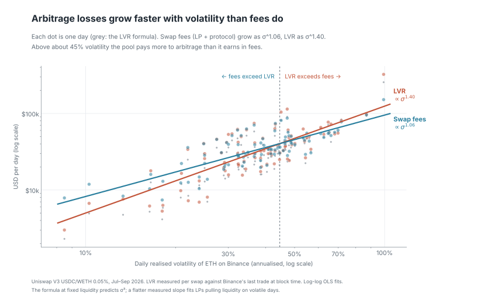

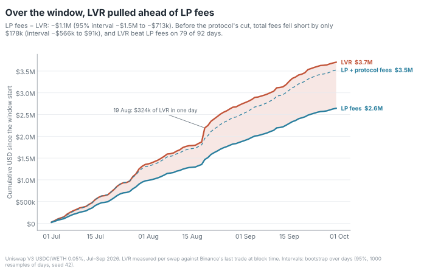

Window totals from [`results/lp_pnl.md`](results/lp_pnl.md), in USD:

| | USD |
|---|---|
| LP fees (after the protocol's quarter) | 2,644,187.17 |
| protocol fees | 881,290.13 |
| measured LVR, 0 s | 3,703,796.76 |
| measured LVR, 12 s | 4,089,325.49 |
| **LP fees − LVR (0 s)** | **−1,059,609.59** |
| LVR on searcher swaps / LP fees on searcher swaps | 4,144,118.00 / 1,976,144.85 |
| theoretical LVR, 1 s returns / 1-minute returns | 3,155,610.48 / 4,325,747.96 |
| theory, expected arbitrage profit (× P_trade) | 931,857.47 |
| theory, expected fees paid by arbitrage (× (1 − P_trade)) | 2,223,753.00 |

The LP fees are net of the protocol's quarter, which is most of the gap: total swap fees (LP +
protocol, `daily.total_fees_usd` in `summary.json`) were 3,525,477.30, short of LVR by 178,319.46.
A bootstrap over the 92 days (1,000 resamples, seed 42, `daily` in `summary.json`) gives 95%
intervals of −1,533,757.96 to −712,591.77 for LP fees − LVR and −566,463.71 to +91,433.73 for
total fees − LVR: the first excludes zero, the second does not. That matches sub-project 2's all-swaps markout of +0.25 bp (−0.14 to 0.77) at
0 s: the pool's counterparties as a whole roughly break even against Binance after the full fee.

Measured LVR is net over every swap: positive when the trade beat Binance, negative when the pool
did. Summed over a swap's steps it equals the sub-project 2 trader markout plus the swap fee, so on
each swap LP fees − LVR is the sub-project 2 LP markout at 0 s; check L6 confirms the identity
over the window to a relative 1e-9.

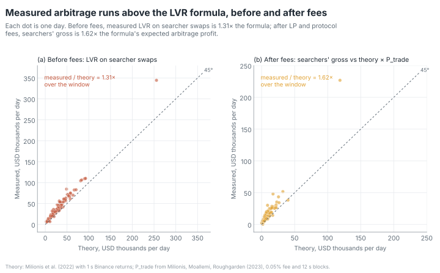

*Theory (figure above): measured LVR on searcher swaps against the theoretical LVR from 1-second
realised variance (`RV × L × √P / 4`, the concentrated-liquidity form of σ²/8 × pool value).
After fees: the searchers' measured gross after LP and protocol fees against the theory's expected
arbitrage profit, the theoretical LVR times P_trade, the probability that a block holds an
arbitrage given the 0.05% fee and 12 s blocks
(Milionis, Moallemi, Roughgarden 2023, which supplies P_trade; the LVR formula is Milionis,
Moallemi, Roughgarden and Zhang 2022).* The formula tracks the measured series day by day but sits
below it on most days. With fees and discrete blocks the model expects arbitrageurs to earn $0.93M
gross and pay $2.22M in fees; measured, searchers' 0 s gross was $1.51M and they paid $1.98M in LP
fees plus $0.66M in protocol fees.

Fees − LVR summed over the days of each tercile of daily realised volatility, from
[`results/vol_regimes.md`](results/vol_regimes.md), USD:

| regime | days | mean σ, annualised | LP fees | LVR (0 s) | theory (1 s) | fees − LVR |
|---|---|---|---|---|---|---|
| low | 30 | 0.24 | 550,621.71 | 702,456.41 | 545,231.48 | -151,834.70 |
| mid | 31 | 0.39 | 842,277.63 | 1,068,876.83 | 910,782.63 | -226,599.20 |
| high | 31 | 0.57 | 1,251,287.82 | 1,932,463.52 | 1,699,596.37 | -681,175.69 |

Fees grow with volatility, but LVR grows faster. These are LP fees, net of the protocol's quarter.
With the protocol's fees added back (`total_fees_minus_lvr_usd` in
[`results/vol_regimes.md`](results/vol_regimes.md)), total swap fees exceed LVR on the low and mid
terciles (+31,703.62 and +54,157.72) and fall short only on the high one (−264,180.80). The same
file splits each regime by LP type: JIT liquidity's fees − LVR (before gas and builder
payments) is positive in all three, wallet-held NFT
positions negative in all three.

## Do arbitrage bots keep the edge?


From
[`results/arbitrage.md`](results/arbitrage.md):

| Step | USD millions |
|---|---|
| Available at block starts, no Binance fee | 1.82 |
| Available with a 1 bp Binance fee | 1.45 |
| Captured: all searchers' 0 s markouts | 1.51 |
| Top bots, single-pool transactions: gross | 1.22 |
| − base fee burned | 0.01 |
| − priority fees | 0.54 |
| − direct coinbase payments | 0.86 |
| = kept (upper bound) | -0.19 |
| Same costs against the 12 s markout: gross | 1.47 |
| = kept at 12 s (upper bound) | 0.06 |

Captured is 0.8281 of available, but it is not a subset of it: it also counts searchers trading
after other swaps in the same block and searcher strategies other than CEX-DEX arbitrage, and on
some days it exceeds available. Top bots, TOTAL row of
[`results/bot_profit.md`](results/bot_profit.md) (single-pool transactions; USD):

| Metric | TOTAL |
|---|---|
| swaps (one per transaction) | 88,002 |
| transactions with a coinbase payment | 56,724 |
| notional | 3,812,483,328.90 |
| gross (0 s markout) | 1,215,557.38 |
| gas burned | 7,828.33 |
| priority fees | 537,509.74 |
| coinbase payments | 862,314.01 |
| kept | -192,094.70 |
| builder income (priority + coinbase) | 1,399,823.75 |
| builder share of gross | 1.15 |
| multi-pool swaps (gross only, no cost split) | 22,987 |
| multi-pool gross | 324,841.08 |

Read "kept" with the caveats in the TL;DR: gross is the edge measured against Binance's last trade
at the block time, not the bots' realised hedge, and missed builder payments would lower "kept"
further (see [Limitations](#limitations)). Its sign depends on the horizon: kept is −$0.19M at the
0 s markout and +$0.06M at 12 s (builder income 115% vs 95% of gross; `kept_usd` and
`kept_12s_usd` in [`results/arbitrage.md`](results/arbitrage.md)).

Per top bot contract (single-pool transactions only), the largest
bot pays builders 1.26 times its gross; the two smallest pay 0.89 and 0.52 times theirs and keep
8,867.73 and 38,004.34 USD.

## Who pays?

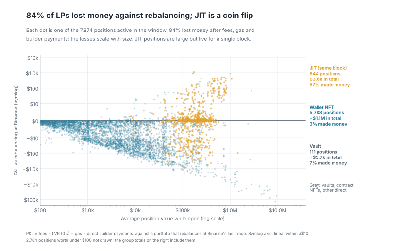

Per window-active position: fees, LVR (0 s), gas of its own window transactions and the direct
payments those transactions made to the block's fee recipient, P&L against a portfolio that
rebalances at Binance's price (`fees − LVR − gas − direct`) and against holding the deposited
tokens, all in USD; the rate is that P&L in bp of the position's hourly time-weighted value per
day, with a 95% bootstrap interval over positions. From
[`results/lp_groups.md`](results/lp_groups.md) (one row per position in
[`results/positions.csv`](results/positions.csv)):

| grouping | group | positions | fees | LVR (0 s) | gas | direct | P&L vs rebalancing | bp/day [95%] | P&L vs holding | share beating holding |
|---|---|---|---|---|---|---|---|---|---|---|
| LP type | jit | 844 | 4,752.92 | -28,934.84 | 19,771.41 | 10,353.71 | 3,562.64 | 1,441.18 [-754.71, 3,555.89] | 3,562.63 | 0.57 |
| | lp_vault | 111 | 12,151.37 | 15,643.43 | 176.30 | 0.00 | -3,668.37 | -1.58 [-3.05, -1.21] | -20,529.53 | 0.32 |
| | nft_wallet | 5,788 | 2,572,025.84 | 3,644,992.64 | 5,495.25 | 0.00 | -1,078,462.06 | -1.35 [-1.77, -1.12] | -18,127,230.35 | 0.19 |
| | nft_contract | 734 | 38,156.22 | 50,739.87 | 1,717.36 | 0.06 | -14,301.08 | -2.28 [-2.77, -1.91] | -74,523.49 | 0.19 |
| | direct_other | 397 | 17,100.83 | 21,355.65 | 708.54 | 4.09 | -4,967.46 | -1.55 [-2.12, -1.08] | -202.64 | 0.38 |
| range width (bp) | <50 | 1,731 | 31,534.02 | 8,612.53 | 20,158.66 | 10,353.71 | -7,590.87 | -6.03 [-19.94, 2.78] | -18,347.69 | 0.36 |
| | 50-200 | 358 | 14,327.44 | 18,361.94 | 387.06 | 0.00 | -4,421.57 | -2.65 [-9.07, -0.90] | -5,679.83 | 0.19 |
| | 200-1000 | 1,158 | 114,084.67 | 148,283.46 | 1,893.20 | 0.00 | -36,092.00 | -2.44 [-5.04, -1.03] | -29,441.91 | 0.26 |
| | 1000-5000 | 2,496 | 1,909,750.05 | 2,755,449.25 | 3,682.81 | 4.15 | -849,386.16 | -1.73 [-3.04, -1.35] | -14,671,928.14 | 0.26 |
| | >=5000 | 2,131 | 574,490.99 | 773,089.57 | 1,747.13 | 0.01 | -200,345.72 | -0.67 [-0.75, -0.61] | -3,493,525.82 | 0.12 |
| holding in window | same_block | 844 | 4,752.92 | -28,934.84 | 19,771.41 | 10,353.71 | 3,562.64 | 1,441.18 [-754.71, 3,555.89] | 3,562.63 | 0.57 |
| | <1h | 364 | 5,014.81 | 6,995.75 | 717.06 | 1.19 | -2,699.19 | -86.81 [-153.97, -42.86] | -7,659.93 | 0.11 |
| | 1h-1d | 982 | 47,377.64 | 91,490.69 | 1,708.17 | 2.90 | -45,824.13 | -34.44 [-67.84, -10.45] | -118,893.02 | 0.31 |
| | 1d-7d | 827 | 181,924.45 | 240,008.66 | 1,614.32 | 0.00 | -59,698.52 | -7.57 [-9.60, -3.87] | -33,331.51 | 0.32 |
| | >=7d | 1,784 | 1,074,902.86 | 1,453,936.54 | 3,738.48 | 0.06 | -382,772.22 | -2.27 [-2.87, -1.67] | -1,760,006.24 | 0.27 |
| | whole_window | 3,073 | 1,330,214.49 | 1,940,299.96 | 319.43 | 0.00 | -610,404.90 | -0.97 [-1.16, -0.64] | -16,302,595.32 | 0.10 |
| cohort | pre_window | 3,837 | 1,559,269.76 | 2,256,207.32 | 1,257.96 | 0.00 | -698,195.53 | -1.01 [-1.22, -0.73] | -17,415,498.80 | 0.09 |
| | in_window | 4,037 | 1,084,917.41 | 1,447,589.44 | 26,610.90 | 10,357.86 | -399,640.79 | -3.38 [-4.51, -2.46] | -803,424.59 | 0.38 |
| all positions | | 7,874 | | | 27,868.87 | 10,357.86 | -1,097,836.32 | | -18,218,923.39 | 0.24 |

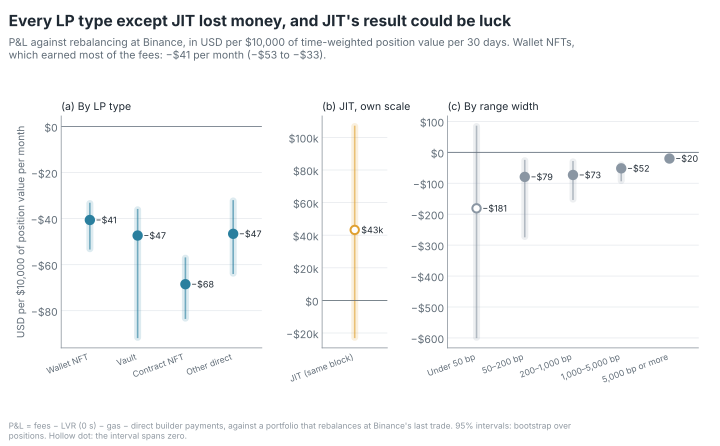

USD per $10,000 of position value per month = bp/day × 30.

- **JIT** liquidity is added just before a swap and removed after it in the same block. Its LVR is
  negative: the flow it trades with loses to the pool against Binance. Its +$3.6k is that negative
  LVR (+28,934.84 to the LP) plus fees (4,752.92), less gas (19,771.41) and direct builder payments
  (10,353.71), and its interval spans zero. Its bp/day figure is large because a JIT position
  counts one 12 s slot of capital. Per swap ([`results/lp_pnl.md`](results/lp_pnl.md), "JIT per
  swap"): the 844 JIT positions were active for 914 swaps (counted per position, between its mint
  and burn in the block), and made +$3.90 per swap against rebalancing ($5.20 of fees, +$31.66 of
  negative LVR, −$21.63 of gas, −$11.33 of direct payments); the median position made +$0.09 per
  swap, so a few positions carry the total.
- **JIT transactions that also swap** (`jit_own_swaps` in `summary.json`): 265 of the 1,662 JIT
  transactions also swap in the pool (298 swaps). They carry $8,711.70 of JIT gas and
  $10,305.31 of its $10,353.71 of direct payments, which may pay for the swap rather than
  the liquidity. Those swaps lost $14,295.61 against Binance at 0 s; the rebalancing benchmark
  takes the LP's own trades as free, so counting them, the JIT operators lost about $10.7k. The
  swaps sit outside the JIT positions' own spans (all but 6, worth −$0.01, come before the
  liquidity is added or after it is removed), so they trade against other LPs, around the swap the
  JIT position serves; the $10.7k is the operators' combined result, with no overlap with JIT's
  negative LVR.

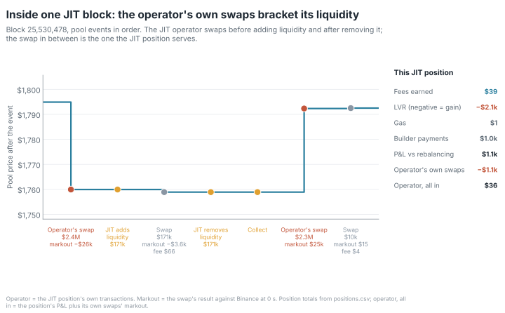

In the block shown (picked by a fixed rule, see [`docs/methodology.md`](docs/methodology.md),
Figures), the operator's first swap moves the pool from $1,794.90 to $1,759.93; its liquidity then
buys the next trader's ETH at that low price, a "negative LVR" of $2,093.08. The position made
$1,125.36 against rebalancing, but the operator's own two swaps lost $1,088.90 against Binance at
0 s: all in, the operator came out $36.47 ahead
([`results/figure_data/jit_block.csv`](results/figure_data/jit_block.csv)).

- **Every other type loses** against rebalancing, at 1.35 to 2.28 bp/day, with intervals below
  zero. No width bucket has a positive point estimate now that direct payments count: narrow
  ranges under 50 bp, which include the JIT positions, are at −6.03 bp/day with an interval that
  spans zero.
- **Shorter holdings lose more per day**: −86.81 bp/day for positions held under an hour,
  −0.97 bp/day for those open the whole window.
- **Against holding**, the totals are much larger (−$18.2M). That gap is the window's price path:
  the rebalancing portfolio's own result against holding, which is zero on average if price moves
  are unpredictable, but not on any one path. Fees − LVR is the part an LP who hedged at Binance's
  price would have kept.

### Lifetime: did window-active positions beat holding?

Over their whole life, from the first deposit to the exit (or the window end), each window-active
position is compared with holding its deposits, valued at the exit price; the return divides by
the deposits valued at their own time (ETHUSDT 1-minute closes before the window). From
[`results/lifetime.md`](results/lifetime.md): 7,874 positions, none excluded for carried owed
tokens; **53.5% beat holding**, median return about zero (`summary.json`: 0.0000089). The
position's gas and direct builder payments inside the window are charged, as in the window result;
costs before the window are not observed. Like the window
result against holding, these shares depend on the price path over each position's life, and so
on when it opened and closed.

| range width (bp) | positions | share beating holding | | lifetime | positions | share beating holding |
|---|---|---|---|---|---|---|
| <50 | 1,731 | 0.63 | | <1d | 2,167 | 0.38 |
| 50-200 | 358 | 0.42 | | 1-7d | 757 | 0.36 |
| 200-1000 | 1,158 | 0.40 | | 7-30d | 837 | 0.46 |
| 1000-5000 | 2,496 | 0.44 | | 30-180d | 1,166 | 0.36 |
| >=5000 | 2,131 | 0.67 | | >=180d | 2,947 | 0.78 |

The median return (a fraction of deposits) is 0.01 for ranges of 5,000 bp or more, 0.09 for
positions with a life of 180 days or more and −0.02 for lives of 30 to 180 days; elsewhere it
rounds to 0.00. The lifetime tables are also in `summary.json` (`lifetime_by_width`,
`lifetime_by_life`). Within the window only 24.1% of positions beat holding; over a whole life the
share is higher, mostly through positions opened long before the window, but a share counts
positions, not dollars. Of the 2,167 positions that lived under a day, 38% beat holding once
their gas and builder payments count: 57% of the 844 JIT positions
(whose lifetime is their window) and 26% of the others.

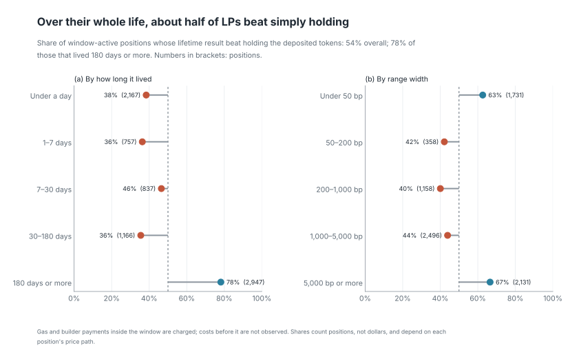

## Where LVR goes

The hero figure at the top draws this split. From [`results/lvr_destination.md`](results/lvr_destination.md), in USD and as shares of the LVR
on searcher swaps (builder margin and proposer payment from the measured payments below):

| Step | USD | share |
|---|---|---|
| pool LVR, 0 s | 3,703,796.76 | |
| − LVR on other flows (non-searcher) | -440,321.24 | |
| = LVR on searcher swaps | 4,144,118.00 | 1.0000 |
| → LP fees | 1,976,144.85 | 0.4769 |
| → protocol fees | 658,714.87 | 0.1590 |
| → searchers' gross (0 s markout) | 1,509,258.29 | |
| of which multi-pool transactions, gross only | 257,681.73 | 0.0622 |
| of which single-pool transactions | 1,251,576.57 | |
| → gas burned | 9,715.89 | 0.0023 |
| → builder margin | 848,648.09 | 0.2048 |
| → proposer payment | 594,782.47 | 0.1435 |
| → kept by searchers (upper bound) | -201,569.88 | -0.0486 |

- 253,280 searcher swaps, all of them costed: every one has an other-logs row, a block in the
  builder/proposer split and gas data.
- The searchers' gross equals sub-project 2's "captured" ($1.51M). Builder payments now come
  from traces, so they cover every searcher, not only the four top bots of sub-project 2.
- Searcher swaps carry more LVR than the whole pool (share 1.1189): the other flows trade at
  prices worse than Binance's and give part of it back.
- LPs recover about half of the searcher LVR as fees and the protocol about a sixth; most of the
  rest goes to the block's builder and proposer (34.8% together).
- **Why kept is negative.** Builder margin plus proposer payment (0.2048 + 0.1435 = 0.3483 of
  searcher LVR) is more than the single-pool gross at 0 s (1,251,576.57, 0.3020 of searcher LVR).
  Gross is measured at the block time against Binance's last trade, so this is a small difference
  of large totals, as in finding 3. Sub-project 2's positive kept at 12 s (+$0.06M) covers the
  top 4 bots only, not every searcher.
- **Proposer versus builder: one split, tested twice.** Each block gets one class from chain
  data only ([methodology section 19](docs/methodology.md#19-proposer-payment-detection)). Its last
  transaction is sent by the fee recipient (554,263 blocks, 79.4% of the $1,443,430.55 that
  single-pool searcher transactions paid builders), or by a payout address the builder keeps apart
  from its fee recipient (44,073 blocks, 20.6%; Titan's fee recipient `0x4838…`, for example, pays
  through `0x9fc3…`). Otherwise the fee recipient is taken to be the proposer, who then receives
  the whole builder revenue: a fee recipient that never pays anyone (56,501 blocks, $23.42), an
  empty block (175) or an unexplained one (4,787 blocks, below). A payout address sent the last
  transaction in at least 50 of a fee recipient's blocks, with value > 0 in at least 99% of them,
  and its fee recipient pays from itself at least once.
- **The two tests.** Both were fixed before their holdout was drawn, with the same bar: 95%
  of the found holdout blocks of the payout class must match the relay within 1 wei and pass a
  check that the relay's proposer was the one paid.

  | | first holdout (seed 44) | second holdout (seed 45) |
  |---|---|---|
  | payout-class blocks found on a relay | 289 | 290 |
  | match the relay's payment within 1 wei | 289 (100%) | 290 (100%) |
  | recipient check | last transaction's `to_address`: 132 (45.7%) | follows forwarders: 290 (100%) |
  | decision | two-sided split kept | one split |

  The first recipient check failed on one contract: 615 of its 616 failures were payments into
  `0xfeeeeee…7ffc`, 20 bytes of code that pass the whole payment on, by `SELFDESTRUCT`, to an
  address in the calldata. Redefining that check and re-scoring the same blocks would have been
  fishing. Instead a check that follows the payment through internal transfers in the same
  transaction was written down and tagged (`forwarder-preregistered`) before a fresh holdout was
  drawn, together with a fix to the classes (two fee recipients that never pay, one of them Lido's
  rewards vault, had been given a spurious payout address). On the fresh holdout it passed 290 of
  290 payout-class blocks, and 232 of 232 blocks paid by the fee recipient (the old check: 117
  and 108). The first decision stays on file as the record of the first test
  ([methodology section 20](docs/methodology.md#20-recipient-check-through-forwarders)).
- **What it replaces.** The README used to give two splits: a primary method that counted the
  16.0% of blocks without a payment from the fee recipient as self-built (proposers 19.0%,
  builders 15.8% of searcher LVR) and a sensitivity (15.4% and 19.4%). The measured split sits
  outside both because most of those blocks were MEV-Boost blocks that paid the proposer from a
  payout address.
- **What is left unexplained:** $630.11 (0.044%) of builder dollars, in blocks that neither pay
  from the fee recipient nor from a payout address. That is too small to move the split, so the
  261 GB trace query once planned for it is not needed. Nothing else in this section depends on
  the split.

> The split of builder payments between builder and proposer uses each block's ratio of proposer payment to builder revenue; how a builder prices an individual transaction is not observed. Proposer payments are identified as the block's last transaction, sent by the fee recipient or by a payout address learned from chain data, and tested on a blind stratified relay sample; blocks where neither applies give the proposer the whole builder revenue.

## Is it the reference price?

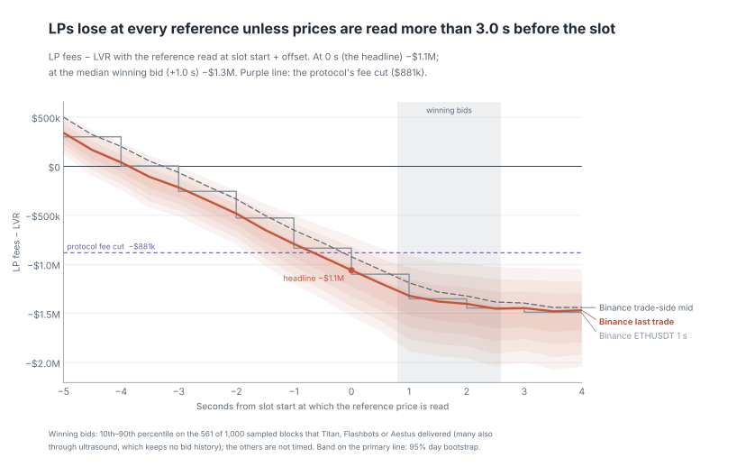

Every number above reads Binance's last ETHUSDC trade at the block timestamp, the start of the
slot. A natural objection is that the loss comes from that choice. It mostly does not: **LPs lost
$1.06M at the block timestamp, and reading the price later only deepens it.** Winning bids reach
the relays about 1 s after slot start, where the loss is $1.31M. A mid-price proxy or a USDT
reference moves it by $0.14M at most. It turns positive only if prices are read more than 3 s
before the slot starts. And $0.88M (83%) of the gap is the protocol's cut of the fees, which no reference price
changes.

| reference, read at | LP fees − LVR | shift from the headline (95% paired interval) |
|---|---|---|
| Binance last trade, slot start (headline) | **−$1.06M** | |
| Binance trade-side mid proxy, slot start | −$0.92M | +$137k (+$119k to +$155k) |
| Binance ETHUSDT 1 s close, slot start | −$1.10M | −$41k (−$83k to +$8k) |
| Binance last trade, 1 s before | −$0.79M | +$269k (+$206k to +$339k) |
| Binance last trade, 1 s after | −$1.32M | −$260k (−$356k to −$193k) |
| Binance last trade, median winning bid (+0.98 s) | −$1.31M | |

- **When the price is read matters more than which price.** Each second near slot start moves
  the result by about $0.26M; the mid proxy moves it by $0.14M, and ETHUSDT's −$41k is within
  day-to-day noise. The three lines cross zero at 3.9 s (last trade), 3.3 s (mid proxy) and
  3.0 s (ETHUSDT, whose 1 s closes only change on whole seconds) before the slot.
- **The block timestamp is the early end of when a block is sealed.** For 561 of 1,000 sampled
  blocks, a relay that delivered the block publishes when it received the winning bid: median
  0.98 s after slot start, 10th–90th percentile 0.80 s to 2.59 s. That time is the latest a
  price could have been acted on in the block; searchers who sent bundles earlier read earlier
  prices. Past about +2 s the curve flattens.
- **The protocol fee switch turns a borderline result into a clear loss.** Before the protocol's
  quarter, total swap fees ($3.53M) nearly cover LVR ($3.70M); the protocol's $0.88M is the
  dashed line in the figure. Any reading above it means total fees beat LVR.

*Caveats:* Binance publishes no bid/ask history for 2026, so the mid is a proxy: the average of
the latest buyer-initiated and seller-initiated trades. One side goes stale, so the two are
crossed at 18% of swap times (median spread 0.12 bp). A block can be delivered by several
relays, and the timing covers the sampled blocks that Titan (490), Aestus (50) or Flashbots (21)
delivered, at least 391 of which ultrasound, the largest relay, also delivered. Missing are the
439 blocks none of the three delivered (20 of them Titan delivered but no longer lists): blocks
that went only through relays without bid history for the window, such as ultrasound, or were
found on no relay. They could be sealed at other times. The ETHUSDT row also carries the
USDT/USDC rate. Full tables:
[`results/reference_robustness.md`](results/reference_robustness.md),
[`results/block_timing.md`](results/block_timing.md) and
[`results/reference_robustness_proxy.md`](results/reference_robustness_proxy.md); method in
[`docs/methodology.md`](docs/methodology.md) section 18.

## Can an LP do better?

**The pre-registered test does not settle range width, and it did not test the fee.** Phase 5
(strategy experiment) fixed its rules on July 2026 data and reports August–September (61 days).
*Range and rebalancing:* **inconclusive**. 24 of the 27 re-centring strategies tested at $1M
hold more than 5% of the pool's active liquidity at their peak, so they are not the small
price-takers the method assumes, and the verdict depends on them; the three that are small
enough, the ±5,000 bp ranges, all stay inside the margin of ±0.068 around full range's
fees ÷ LVR. *Fee level:* **not tested**, because the model failed its July calibration (its
arbitrage LVR was 1.38 times the measured one, against a tolerance of ±15%), so every fee number
below is model-only. *Hedge:* no test, by design: it is the risk lever. An hourly perpetual hedge
cuts the spread of a full-range position's daily P&L about 100-fold and leaves fees − LVR where
it was, because the benchmark is already the hedged LP. Every number in this chapter is a
counterfactual that ignores how other traders would react to a different range, fee or hedge.

The hypothesis, written down before any August–September strategy result existed (the window's
aggregate results were already known; see [Limitations](#strategy-experiment-phase-5)). It is
what was tested, not a result ([spec](docs/superpowers/specs/2026-10-21-strategy-experiment-design.md),
section 1):

> A passive LP in this pool can't fix the loss by choosing a better range or hedging. Those change
> the risk and the gas bill, not the gap between fees and LVR. Only the fee itself moves that gap:
> its level, when it's charged, or the protocol's cut. Here's by how much, after costs, tested out
> of sample.

### Which levers can work, and why

- **Hedge.** The −$1.06M is already measured against a rebalancing portfolio, which is the LP
  hedged continuously and for free at Binance's price. A Binance hedge cannot change fees − LVR;
  it adds trading and funding costs. What it changes is risk: over the window, the 7,874
  positions lost $18.2M against holding their deposited tokens, but $1.10M against the
  rebalancing portfolio after gas and direct builder payments (pool-level LP fees − LVR, before
  those costs, is −$1.06M). So the hedge has no test: "it leaves fees − LVR unchanged" is an
  identity of the benchmark.
- **Range width and re-centring.** While the price is in range, a narrower range scales fees and
  LVR by the same factor. It adds gas, re-centring trades and time out of range. Expected: it
  moves costs and risk, not fees ÷ LVR.
- **Fee level and dynamic fees.** The fee is the lever that touches LVR directly: at a higher fee
  arbitrageurs trade less often and pay more each time.
- **Protocol cut.** A pool-design choice, not an LP strategy, and arithmetic, not a model: $0.88M
  of the $1.06M gap. Reported, not tested.
- **JIT** is left out of the grid: it was the one LP type with a positive total
  ([Who pays?](#who-pays)), but it depends on seeing the order flow before the block lands, which
  is not a passive LP's choice.

### How it was pre-registered

- **July chooses, August–September reports.** Every parameter, margin and tolerance is fixed in
  `strategy/params.py`. A first run on July only computed the full-range position's
  fees ÷ LVR, r₀ = 0.729, and from it the margin δ = (1 − r₀) / 4 = 0.068; the minimum profit
  for the simulated arbitrage (the block's base fee × 137,345 gas, the median of July's
  single-pool searcher transactions); the LP gas costs (July medians: 408,316 gas to mint,
  208,475 to burn and collect, a 0.25 gwei priority fee); the calibration verdict; and the
  reader-facing best strategy (±5,000 bp re-centred at the band, −0.82 bp/day in July). It wrote
  them to [`results/strategy_freeze.json`](results/strategy_freeze.json), which was committed
  (`f565e41`) and tagged `strategy-preregistered` before any August–September strategy result existed.
  The report run reads every July value from that file, stops if any of the inputs it hashed has
  changed, and never rewrites it.
- **Two gates first** ([`results/strategy_checks.md`](results/strategy_checks.md)). S2
  replays the window through the counterfactual pool at 5 bp with nothing replaced and reproduces
  the real pool exactly: 659,799 blocks, 586,360 swap steps, 534,377 swaps, 0 mismatches. S1
  scores all 7,874 window-active positions with the new range formula and matches the engine's
  fees and LVR within a relative 1e-9. It passes with little room: the largest error is 9.4e-10
  (LVR).
- **Two ratios per strategy:** fees ÷ LVR (LP fees after the protocol's cut ÷ LVR at 0 s), the
  test metric, and the return against rebalancing in bp of time-weighted capital per day, after
  gas, re-centring trades and hedge costs. Every comparison is paired: strategy minus full range
  on the same 1,000 resampled days (seed 42).

### Range width and rebalancing

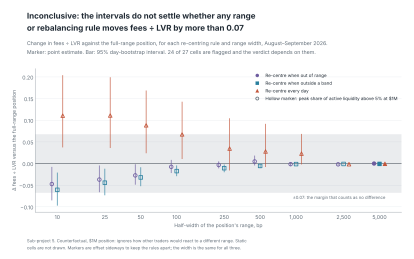

Each strategy is a $1M position, started fresh on 2026-08-01, that takes its share of every
recorded swap step without changing the swaps (a price-taker). It is re-centred on the price when
the price leaves the range (*out of range*), when it leaves the inner half of the range
(*band*), or at the first block of each UTC day (*daily*). Change in fees ÷ LVR against full
range, with the 95% paired day-bootstrap interval, from
[`results/strategy_ranges.md`](results/strategy_ranges.md); **bold**: the interval is not inside
±δ = ±0.0677. Every row but ±5,000 bp is flagged (peak share of active liquidity above 5%).
Counterfactual: ignores how other traders would react to a different range.

| half-width | out of range | band | daily |
|---|---|---|---|
| ±10 bp | **−0.047 [−0.085, −0.008]** | **−0.061 [−0.097, −0.021]** | **+0.111 [+0.037, +0.204]** |
| ±25 bp | −0.037 [−0.066, −0.004] | **−0.044 [−0.073, −0.012]** | **+0.111 [+0.036, +0.199]** |
| ±50 bp | −0.027 [−0.049, −0.002] | −0.032 [−0.052, −0.009] | **+0.088 [+0.024, +0.169]** |
| ±100 bp | −0.008 [−0.022, +0.008] | −0.017 [−0.029, −0.004] | **+0.067 [+0.010, +0.143]** |
| ±250 bp | −0.003 [−0.011, +0.005] | −0.011 [−0.020, −0.002] | **+0.035 [−0.016, +0.105]** |
| ±500 bp | +0.005 [−0.005, +0.018] | −0.005 [−0.011, −0.001] | **+0.028 [−0.008, +0.092]** |
| ±1,000 bp | −0.001 [−0.006, +0.002] | −0.001 [−0.002, 0.000] | **+0.023 [−0.002, +0.068]** |
| ±2,500 bp | −0.002 [−0.004, 0.000] | −0.001 [−0.002, 0.000] | −0.001 [−0.003, 0.000] |
| ±5,000 bp | 0.000 [0.000, 0.000] | −0.001 [−0.002, 0.000] | −0.001 [−0.001, 0.000] |

- **Inconclusive, and it hangs on the flagged cells.** No interval lies entirely above +δ, which
  would have failed the hypothesis, but 10 of the 27 are not inside ±δ, all of them flagged. The
  three unflagged cells, the ±5,000 bp ranges, are inside: on them alone the hypothesis would
  hold.
- **The point estimates above +δ** are daily re-centred ranges of ±10 to ±50 bp (+0.088 to
  +0.111), with lower bounds of +0.024 to +0.037, below δ. Such a range is out of range most of
  the time (±10 bp re-centred daily is in range at 18% of block starts), so it misses in-range LVR
  when the price trends away during the day; that reading is an interpretation, not tested.
  Re-centring at the range or band edge instead lowers the ratio slightly at narrow widths.
- **Size changes the flag, not the ratio.** Fees and LVR scale with the position, so fees ÷ LVR
  and its intervals are the same at $100k. There only 12 of the 27 cells are flagged (±10 to
  ±100 bp), but the daily ±250 to ±1,000 bp cells, unflagged at $100k, still reach above +δ: a
  smaller LP would not settle it either (derived from the size invariance of fees ÷ LVR; not
  re-run at $100k). The test itself is pre-registered at $1M.

Return against rebalancing, in bp of time-weighted capital per day, at $1M with a 5 bp taker fee
on re-centring trades (number of re-centrings in brackets); full range: −0.19 bp/day.
Counterfactual: ignores how other traders would react to a different range.

| half-width | out of range | band | daily |
|---|---|---|---|
| ±10 bp | −454.46 (8,111) | −623.74 (25,126) | −14.48 (60) |
| ±25 bp | −203.47 (2,649) | −306.90 (9,649) | −13.60 (60) |
| ±50 bp | −106.85 (964) | −143.90 (3,445) | −14.21 (60) |
| ±100 bp | −46.48 (288) | −60.64 (1,082) | −13.44 (60) |
| ±250 bp | −17.00 (56) | −19.76 (200) | −10.12 (60) |
| ±500 bp | −7.59 (9) | −8.82 (54) | −6.48 (60) |
| ±1,000 bp | −3.93 (3) | −4.03 (9) | −3.63 (60) |
| ±2,500 bp | −1.65 (1) | −1.66 (3) | −1.77 (60) |
| ±5,000 bp | −0.87 (0) | −0.87 (1) | −0.93 (60) |

- **Costs, not the ratio, decide the return.** Every re-centring strategy lost against
  rebalancing, and narrower ranges lost more: re-centring a ±10 bp range each time the price
  leaves it took 8,111 re-centrings and returned −454 bp/day (−245 with a 1 bp taker fee, −717
  with 10 bp). Even before costs a narrower range loses more per dollar, because it multiplies
  the same fees − LVR, which is negative here: the ±5,000 bp ranges return −0.87 bp/day against
  full range's −0.19.
- **Static ranges** (descriptive, not part of the test) mostly measure where 2026-08-01 happened
  to sit: a ±10 bp range set then and never moved was in range at 0.8% of block starts, on 7 of
  61 days.

### Fee level, dynamic fee and protocol cut

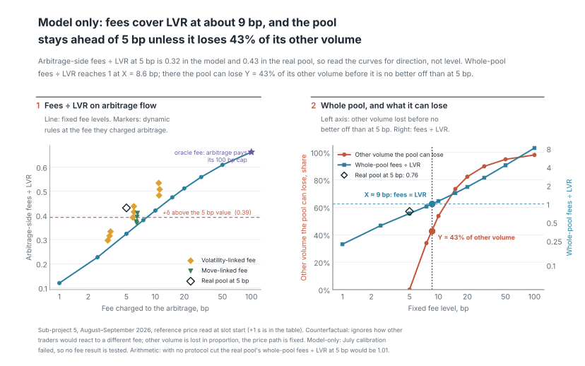

**Model-only.** The fee results come from a second pool carried forward block by block at the
counterfactual fee. A simulated arbitrage trades first in each block, against Binance at the
block time with a 1 bp Binance fee, in place of the 99,890 single-pool searcher swaps; every
other swap is re-executed at its logged size. In the July calibration this model's arbitrage
LVR was 1.38 times the measured LVR of the swaps it replaces (1.33 with Binance read 1 s
later), outside the pre-registered ±15%; its fees were 1.05 times the measured ones. So the fee
test is "not tested (calibration failed)", as pre-registered, and every fee number is model-only.
A plausible reason, not tested: the simulated arbitrage takes the whole gap to the fee band at
every block start, more than real searchers took (sub-project 2: captured was 0.83 of
available). It shows at 5 bp too: the model's arbitrage-side ratio is 0.32, the real pool's 0.43,
so read the curves for direction, not level.

Fixed fee levels, August–September, from [`results/strategy_fees.md`](results/strategy_fees.md)
(Δ against the 5 bp model run, 95% paired interval; model-only; counterfactual: ignores how
traders would react to a different fee):

| fee | arbitrage-side fees ÷ LVR | Δ vs 5 bp model | whole-pool fees ÷ LVR, constant volume | other volume the pool can lose | bp/day |
|---|---|---|---|---|---|
| 1 bp | 0.12 | −0.20 [−0.23, −0.18] | 0.22 | −125% | −0.65 |
| 2.5 bp | 0.23 | −0.10 [−0.11, −0.09] | 0.44 | −60% | −0.46 |
| 5 bp (model) | 0.32 | | 0.70 | | −0.25 |
| 7.5 bp | 0.38 | +0.06 [+0.05, +0.06] | 0.91 | 34% | −0.07 |
| 10 bp | 0.42 | +0.10 [+0.09, +0.10] | 1.11 | 54% | +0.09 |
| 15 bp | 0.47 | +0.15 [+0.14, +0.16] | 1.51 | 73% | +0.42 |
| 20 bp | 0.51 | +0.19 [+0.18, +0.20] | 1.90 | 82% | +0.75 |
| 30 bp | 0.56 | +0.23 [+0.22, +0.25] | 2.68 | 90% | +1.40 |
| 50 bp | 0.61 | +0.29 [+0.27, +0.30] | 4.29 | 95% | +2.70 |
| 100 bp | 0.66 | +0.34 [+0.32, +0.35] | 8.19 | 98% | +5.92 |
| real pool, 5 bp | 0.43 | | 0.755 | | −0.19 |

**At constant volume, LPs break even at about 8.6 bp, and at that fee the pool can lose at most
43% of its other volume before LPs are no better off than at 5 bp.** Model-only, and a
counterfactual that ignores how traders would react to a higher fee: kept flow stays at its
logged size at every fee, and the 43% assumes removed flow takes its fees and LVR with it in
proportion and leaves the price path unchanged. It is the room that shortcut leaves, not a
forecast of how much flow would leave. Below 5 bp the share is negative: the pool would need
more other volume, not less. The arbitrage-side ratio rises with the fee, from 0.12 at 1 bp to
0.66 at 100 bp: the mechanism the spec argues for shows up in the model, untested. Reading
Binance 1 s later raises the arbitrage-side ratios by about 0.01 to 0.02 (in the full table,
[`results/strategy_fees.md`](results/strategy_fees.md)).

Dynamic fees, from on-chain inputs only, each at its average charged fee (model-only;
counterfactual: ignores how traders would react to a different fee):

| rule | average fee | arbitrage-side fees ÷ LVR | Δ vs 5 bp model | whole-pool fees ÷ LVR | other volume the pool can lose |
|---|---|---|---|---|---|
| volatility, k = 1, half-life 25 blocks | 2.3 bp | 0.33 | +0.01 [−0.04, +0.05] | 0.76 | 10% |
| volatility, k = 1, 150 blocks | 2.5 bp | 0.32 | −0.01 [−0.05, +0.03] | 0.71 | 2% |
| volatility, k = 1, 900 blocks | 2.8 bp | 0.30 | −0.03 [−0.06, +0.00] | 0.65 | −11% |
| volatility, k = 2, 25 blocks | 4.0 bp | 0.44 | +0.11 [+0.07, +0.16] | 1.17 | 55% |
| volatility, k = 2, 150 blocks | 4.5 bp | 0.41 | +0.09 [+0.05, +0.13] | 1.09 | 49% |
| volatility, k = 2, 900 blocks | 5.1 bp | 0.39 | +0.07 [+0.03, +0.10] | 0.98 | 40% |
| volatility, k = 4, 25 blocks | 7.1 bp | 0.53 | +0.21 [+0.17, +0.25] | 1.79 | 80% |
| volatility, k = 4, 150 blocks | 8.2 bp | 0.51 | +0.18 [+0.14, +0.23] | 1.70 | 78% |
| volatility, k = 4, 900 blocks | 9.4 bp | 0.48 | +0.16 [+0.12, +0.19] | 1.53 | 73% |
| move, k = 0.5 | 5.4 bp | 0.41 | +0.09 [+0.07, +0.10] | 0.92 | 37% |
| move, k = 1 | 5.7 bp | 0.39 | +0.07 [+0.05, +0.09] | 1.01 | 44% |
| move, k = 2 | 6.4 bp | 0.37 | +0.05 [+0.03, +0.07] | 1.17 | 54% |
| move, k = 4 | 7.6 bp | 0.37 | +0.04 [+0.01, +0.07] | 1.43 | 64% |
| oracle (upper bound) | 37.8 bp | 0.66 | +0.34 [+0.32, +0.36] | 4.44 | 96% |

- **Volatility fees** (k × a moving average of the pool's own block-to-block volatility) reach
  higher arbitrage-side ratios than a fixed fee of the same average: k = 4 with a 25-block
  half-life averages 7.1 bp and reaches 0.53, against 0.38 for a fixed 7.5 bp. **Move fees**
  (5 bp + k × the pool's last block move) sit closer to the fixed curve: k = 4 averages 7.6 bp and
  reaches 0.37.
- **The oracle fee**, the larger of 5 bp and the gap to Binance at the block start, averages
  37.8 bp and reaches 0.66, about what a fixed 100 bp gives. It reads Binance, which a pool cannot,
  so it is an upper bound only and in no test.
- **Protocol cut, arithmetic.** In the real pool over August–September, full range's
  fees ÷ LVR is 0.755 at the actual cut of 1/4; at 1/10 it would be 0.906, and with no cut 1.007,
  a return of +0.005 bp/day instead of −0.19. No model is involved: LP fees scale by
  (1 − cut) / (1 − 1/4).

### Hedge: the risk lever


The rebalancing benchmark is the LP hedged continuously and for free at Binance's price, so
fees − LVR is already the hedged result: **a hedge changes the spread of P&L, not
fees − LVR** (an identity of the benchmark, not a finding). Delta hedge of the position's WETH
with the Binance ETHUSDC perpetual, $1M, a 5 bp taker fee on hedge trades, funding included, from
[`results/strategy_hedge.md`](results/strategy_hedge.md) (USD per $1M; counterfactual: ignores how
other traders would react):

| position | hedge | mean daily P&L | SD of daily P&L | bp/day |
|---|---|---|---|---|
| full range | none | 3,355 | 16,397 | 30.06 |
| | daily | 17 | 466 | 0.15 |
| | hourly | 46 | 160 | 0.41 |
| | at 10% drift | −182 | 1,770 | −1.63 |
| | rebalancing benchmark | −21 | 39 | −0.19 |
| ±5,000 bp, band | none | 2,920 | 13,828 | 26.73 |
| | daily | 1 | 2,410 | 0.01 |
| | hourly | −109 | 606 | −1.00 |
| | at 10% drift | −133 | 1,725 | −1.22 |
| | rebalancing benchmark | −95 | 179 | −0.87 |

- **Hedging hourly cuts the full-range position's daily spread from $16.4k to $160**, about
  100-fold; the free continuous hedge (the benchmark) has $39. Daily re-hedging leaves $466;
  re-hedging only when the hedge drifts by 10% of the position's value leaves $1,770 and lost
  $182 a day.
- **The unhedged mean (+$3,355 a day) is the period's price path**, not LP income. For full
  range, the daily and hourly hedges end above the benchmark (+$17 and +$46 against −$21 a day),
  likely through funding: the short received roughly $75–100 a day (estimated from the funding
  files: about $74 on a fixed $500k short, about $104 on a short that grows with the price as the
  full-range position's WETH does, $0.49M to $0.91M; not broken out in the results), part of
  which hedge trading costs take back. Not every hedge ends above its benchmark: full range at
  10% drift ends at −$182, and the ±5,000 bp band at −$109 hourly and −$133 at drift, against its
  benchmark's −$95 (its daily hedge, +$1, is above).
- For the ±5,000 bp band, the best July strategy, an hourly hedge cuts the spread from $13.8k to
  $606, but its costs turn the mean to −$109 a day.

Full tables, with the static cells, the $100k sensitivity, the +1 s fee runs and the 1 bp and
10 bp taker fees: [`results/strategy_ranges.md`](results/strategy_ranges.md),
[`results/strategy_fees.md`](results/strategy_fees.md),
[`results/strategy_hedge.md`](results/strategy_hedge.md) and the verdicts in
[`results/strategy_test.md`](results/strategy_test.md); method in
[`docs/methodology.md`](docs/methodology.md) section 21.

## Data

Study window: `[2026-07-01, 2026-10-01)` UTC. Pool: USDC/WETH 0.05%
(`0x88e6a0c2ddd26feeb64f039a2c41296fcb3f5640`). Token0 is USDC (6 decimals), token1 is WETH
(18 decimals), fee 500 pips, tick spacing 10.

| Source | What | How |
|---|---|---|
| Uniswap V3 pool `0x88e6…5640` | All pool logs in the window (Swap, Mint, Burn, Collect, Flash, CollectProtocol), block timestamps, tx sender/recipient | BigQuery `bigquery-public-data.crypto_ethereum`, one file per month |
| Archive RPC | Full tick book at the snapshot block just before the window; pool state at 500 random blocks inside it | Starts the replay and validates it |
| Binance | ETHUSDC aggregated trades (one row per taker order at one price, µs timestamps; primary reference price) and ETHUSDT 1-second candles | [data.binance.vision](https://data.binance.vision), checksum-verified |

**What was collected.** 556,664 pool logs: 534,377 swaps, 5,616 mints, 8,115 burns, 8,119 collects,
57 flash and 380 collect_protocol. From Binance: 15,296,344 ETHUSDC trades and 7,948,800 ETHUSDT
1-second candles (complete).

**How liquidity is reconstructed.** Pool logs say what changed, not the full state, so the tick book
is rebuilt by replaying events in `(block, log_index)` order, starting from an on-chain snapshot of
the full tick book at block 25,433,938 (2026-06-30 23:59:59 UTC). State values (prices, liquidity)
are exact integers: Python `int` in code, `Int128` in Polars, and `Decimal(38, 0)` in the parquet
files (so pyarrow, pandas and DuckDB can read them too; use `uniswap_lp_economics.io.read_exact` to
get `Int128` back in Polars). Floats appear only in readable columns such as `amount_usdc`,
`amount_eth` and `price_usd`.

**Protocol fee.** Read from chain, `feeProtocol` is 68 (`0x44`) at the snapshot block and throughout
the window: the protocol takes 1/4 of every swap fee, in both tokens. There were no `SetFeeProtocol`
events in the window, and 380 `CollectProtocol` events. LP fee income in later stages therefore has
to be computed net of the protocol's quarter.

**Added for LP P&L (sub-project 3).** Positions open at the window start were created earlier, so
the pool's full history is needed to know their state and their LP:

| Source | What | How |
|---|---|---|
| Pool and NonfungiblePositionManager logs, 2021-05-04 to the window end | Every `Mint`/`Burn`/`Collect`, and the NFT positions' `IncreaseLiquidity`/`DecreaseLiquidity`/`Collect`/`Transfer` | BigQuery, one paid query (2.98 TB scanned) |
| Archive RPC | Fee-growth state at the snapshot and at the 500 sample blocks; every position's stored state at the window's start and end; whether each LP address has contract code | `eth_call` batched through Multicall3, `eth_getCode` |
| BigQuery transactions, traces and logs | Per block: builder revenue, proposer payment and the last transaction's recipient and gas; per transaction touching the pool: payments to the block's fee recipient and logs from other contracts | Aggregated inside BigQuery (about 676 GB scanned) |
| MEV-Boost relays | Relay-reported proposer payments for 1,000 random window blocks and two 600-block holdouts | Public data APIs, cross-check only |
| Binance | ETHUSDT 1-minute candles since the pool's creation | data.binance.vision, checksum-verified |
| `labels/lp_addresses.csv` | Four LP vaults named on Etherscan, with source links | Curated |

**Added for the strategy experiment (Phase 5).** Binance USDⓈ-M ETHUSDC perpetual funding rates
and 1-minute klines for July–September, from data.binance.vision, checksum-verified (the hedge
instrument). No new BigQuery query.

### Validation

Full report: [`data_validation/validation_report.md`](data_validation/validation_report.md)
(machine-readable: `validation_report.json`, which also lists a SHA-256 prefix of every input file
and the git commit). Overall status: **PASS**.

| Check | What it compares | Result |
|---|---|---|
| C1 | Active liquidity from the replayed tick book vs the `liquidity` value emitted in each Swap event | 534,377 swaps, 0 mismatches |
| C2 | Each swap's reported tick vs the tick implied by its `sqrtPriceX96` | 534,377 swaps, 0 mismatches (2 of them stop exactly on a tick boundary) |
| C3 | Replayed state vs on-chain `slot0`, `liquidity()` and `ticks()` at 500 random blocks (5 of them with the full set of initialized ticks) | 500/500 blocks, 17,625 ticks compared, 0 mismatches, 0 blocks missing data |
| C4 | Snapshot self-consistency | 1,557 initialized ticks; `liquidity_net` sums to 0; rebuilt active liquidity 2,811,825,879,343,074,188 equals on-chain `liquidity()` |
| C5 | Raw data integrity | 556,664 logs, 0 duplicates, 0 without a transaction, 0 outside the window, 0 of unknown event type; 6 Binance files, no bad checksums |
| C6 | Pool price vs the last Binance ETHUSDC trade before each swap | 534,377/534,377 matched; median gap 3.757 bp (gated: must be below 10 bp); 95th percentile 6.656 bp (reported, not bounded) |

What this proves and what it does not:

- C1 and C3 are exact-integer comparisons. Together they show that our reconstruction of in-range
  liquidity matches the chain at every swap and at 500 randomly chosen blocks. The fee and LVR
  calculations depend on that. It is a statement about this pool and this window, not a general
  proof that the replay code is correct for other pools.
- C3 checks a sample of blocks and ticks (the 20 initialized ticks nearest the price at each block,
  taken from the on-chain bitmap, plus the full book at 5 blocks), not every tick at every block.
  C1 covers every swap; C3 checks more fields (ticks not crossed by swaps) at sampled blocks.
- The C6 median is a sanity bound that catches gross errors such as a wrong decimal or an inverted
  price. It is not a finding, and it says nothing about who gains or loses from the pool/CEX gap.
- C5 reports a longest gap of 169.371924 s between consecutive Binance ETHUSDC trades. That is a
  property of the data, not a defect, but the CEX price at a swap can be that stale in quiet periods.

## Method

Every definition and formula: [`docs/methodology.md`](docs/methodology.md).

1. **Reference and time zero:** Binance's last ETHUSDC trade at or before the time; t0 = block
   timestamp; horizons 0 s, 12 s, 1 min, 5 min and 1 h.
2. **Markouts:** each swap's trader-side gain or loss against that price, after the swap fee, in USD
   and bp of notional; notional-weighted by group, with 95% intervals from a day bootstrap.
3. **Flow labels:** a curated address list (Uniswap routers, aggregators, intent settlement), then
   `searcher` when the pool's caller is the transaction's target, else `other_contract`.
4. **Price discovery:** per-block basis between pool and Binance, gap episodes and who closes them,
   cross-correlation of returns, AR(1) half-life of the basis.
5. **Available → captured → kept:** optimal arbitrage at each block start by exact-integer V3 swap
   simulation; searchers' 0 s markouts; the top bots' gross minus gas and builder payments.
6. **Positions and fees, exactly as the contract keeps them:** every swap is re-simulated step by
   step, and the pool's fee-growth accounting is replayed in exact integers alongside parallel
   float accumulators for USD fees and LVR. Positions are rebuilt from the pool's full history (one
   per NFT; direct positions split each time their liquidity returns to zero), and their stored
   state matches the chain at both ends of the window.
7. **LVR and P&L:** measured LVR per swap step = the pool's token change, fee excluded, valued at
   Binance (`−(Δusdc + Δeth × P_cex)`); theoretical LVR from realised variance and the active
   liquidity. Per position: P&L against rebalancing (fees − LVR − gas − direct builder payments)
   and against holding, in bp
   of hourly time-weighted value per day, with 95% bootstrap intervals over positions; and a
   lifetime result against holding.
8. **Where LVR goes:** LVR on searcher swaps → LP fees, protocol fees and the searchers' gross;
   gross → gas burned, builder margin, proposer payment and what the searcher kept, using every
   searcher transaction's payments to the block's fee recipient (from traces).

## Limitations

### Price discovery and markouts (sub-project 2)

> Builder payments are detected only as direct ETH transfers from the bot contract to the block's fee recipient within the same transaction. Payments routed elsewhere (another contract, a separate transaction in the bundle, off-chain agreements) are missed, so the reported net profit is an **upper bound** on what the bots keep. Binance-side trading fees, inventory and hedging costs are not observed.

- **Reference = last Binance trade.** There is no order-book data for the window, so no mid price,
  and Binance is the only reference venue. 73,139 swaps have a 0 s reference older than 5 s; the
  robustness variant without them changes little.
- **t0 = block timestamp** (whole seconds, the start of the 12-second slot), while Binance trades
  carry sub-second timestamps and the bots' decision and hedge times are not observed. Short-horizon
  markouts depend on this choice (the searchers' 0 s edge is 1.80 bp with t0 − 2 s). For LP fees
  − LVR, [Is it the reference price?](#is-it-the-reference-price) measures how far this goes.
- **Available arbitrage ignores gas, Binance fees beyond the 1 bp sensitivity, and Binance depth.**
  It assumes the arbitrage is the first trade at the block-start state, and a gap that stays open is
  counted again at each block start, so it is not what one arbitrageur could have taken.
- **Labels are a curated list plus heuristics.** `searcher` is a structural pattern (the pool's
  caller is the transaction's target), not a verified identity, and 0.11 of notional stays
  `other_contract`; the two largest unlabelled addresses are unverified contracts with no public
  name tag.
- **Failed bot transactions are not counted.** A reverted transaction, or one that exits without
  trading, emits no Swap log in the pool, so its gas never enters the cost side. This is a further
  reason the bots' net profit is an upper bound.
- **Multi-pool bot transactions get no cost breakdown:** their costs also pay for trades in other
  pools, so they are reported gross only.
- **Builder income** is income of the block's fee recipient, usually the builder; what the builder
  passes on to the validator is not measured here (sub-project 3 splits it for searcher swaps, see
  [Where LVR goes](#where-lvr-goes)).
- **Statistics:** the bootstrap resamples UTC days and treats them as independent; for a thin group
  the interval is conditional on at least one active day and can be narrow.
- **Scope:** one pool and one quarter; nothing here is tested on other pools or periods.

### LP P&L and where LVR goes (sub-project 3)

> The split of builder payments between builder and proposer uses each block's ratio of proposer payment to builder revenue; how a builder prices an individual transaction is not observed. Proposer payments are identified as the block's last transaction, sent by the fee recipient or by a payout address learned from chain data, and tested on a blind stratified relay sample; blocks where neither applies give the proposer the whole builder revenue.

- **Reference price.** Measured LVR, fees in USD and every P&L use Binance's last ETHUSDC trade, as
  above. [Is it the reference price?](#is-it-the-reference-price) re-measures it against a
  trade-side mid proxy, ETHUSDT and other read times.
- **Theory** assumes geometric Brownian motion and blocks arriving as a Poisson process, while
  Ethereum slots are a fixed 12 s. The 1-minute version gives about a third more LVR than the
  1-second one. Order-flow noise in last trades would push 1-second realised variance above the
  1-minute one; it comes out below, so at 1 s stale stretches of the last trade (the price
  catching up over several seconds) dominate, and noise does not.
- **LP hedging and other holdings are not observed.** P&L against rebalancing is what an LP who
  could rebalance for free at Binance's last trade would have made.
- **LP gas and builder payments** are counted only for window transactions, in the window and
  the lifetime results alike; costs before the window are not observed. A JIT transaction that also
  swaps may pay the builder for the swap, and the rebalancing benchmark takes the LP's own swaps as
  free.
- **Lifetime values before the window** use ETHUSDT 1-minute closes (quoted in USDT).
- **Who the LP is.** An NFT position's LP is its owner at close (570 window-active positions
  changed owner while open), and a vault stands for many depositors. Only four vault addresses are
  labelled (those Etherscan names as vaults); other managers stay `nft_contract` or
  `direct_other`. EIP-7702 delegated wallets count as wallets.
- **Small accounting edges, reported:** NFT collects keep the amounts the position manager
  requested, which can exceed what the pool paid by up to 48 raw USDC units or 44 wei (2,622
  collects in the pool's history); a direct position re-minted before its owed tokens were collected
  hands them to the next position, and such positions are left out of the lifetime statistics (none
  among the window-active positions).
- **Where LVR goes:** "kept" is an upper bound (builder payments outside the transaction and
  failed transactions are missed). A transaction that both swaps and moves JIT liquidity has its
  gas and builder payments counted twice, as the searcher's cost here and as the LP's cost in the
  P&L tables: at most $19,017 in this window (the 265 such transactions).
  The two analyses are never added together. The proposer/builder split (proposers 14.4%, builders 20.5% of searcher LVR) comes
  from measured payments that passed a pre-registered relay test on the second attempt; the
  first attempt's failed recipient check stays published beside it (methodology sections 19 and
  20). Blocks left unexplained ($630.11 of builder dollars, 0.044%) give the proposer the whole
  builder revenue. The sum (34.8%) does not depend on the split. The relay sample found 771 of
  1,000 blocks; bloXroute's max-profit relay, down throughout, left 188 of them and 75 and 78
  blocks of the two holdouts without an answer.
- **Statistics:** the P&L intervals bootstrap positions and treat them as independent, though many
  positions share an LP.

### Reference and timing robustness (sub-project 4)

- **The mid price is a proxy.** There is no Binance bid/ask history for the window; the
  trade-side proxy is crossed at 18% of swap times. A true mid needs another venue's order book
  (OKX publishes one, 2.9 GB for ETH-USDC), which would mix venue and mid effects.
- **Timing covers the blocks three relays delivered.** Winning-bid times come from Titan,
  Aestus and Flashbots, the relays that keep bid history for the window: 561 of 1,000 sampled
  blocks, many also delivered through ultrasound. The 439 blocks none of the three delivered are
  missing. The received
  time is when the final block reached the relay, not when each searcher read a price.
- **The headline stays at the block timestamp.** Sub-projects 2 and 3 are not re-run at the
  measured time; the robustness table re-prices LP fees − LVR only, through the L6 identity.

### Strategy experiment (Phase 5)

- **Out of sample for the parameters, not for the analyst.** Every parameter was fixed on July and
  frozen before August–September was computed, but the window's aggregate results
  (sub-projects 2–4) were known when the hypothesis was written.
- **Price-takers.** A strategy position takes its share of the recorded swaps without changing
  them. 24 of the 27 tested cells are flagged because at their peak they hold more than 5% of the
  active liquidity (up to 84%); a position that large would change the swaps it trades against.
  The flag is in the table, and the verdict depends on the flagged cells.
- **No routing model; fixed volume.** Where flow would go at a higher fee (the 0.3% pool, other
  venues) is not modelled. Kept flow is re-executed at its logged size at every fee; the
  break-even share assumes removed flow takes its fees and LVR with it in proportion and leaves
  the price path unchanged.
- **The fee model failed calibration**, so every fee number is model-only (see the chapter). The
  simulated arbitrage always trades first in the block and closes the whole gap to the fee band;
  real arbitrage sometimes trades after other swaps, and takes less.
- **Swap modes.** Kept swaps are re-executed in the mode check L1 found first (exact input, then
  exact output, then to price). A swap that was really exact output but reproduces as exact input
  at 5 bp is re-executed as exact input; at 5 bp the two cannot be told apart.
- **What is replaced.** "Searcher" is a contract that receives the transaction and calls the
  pool, not proven CEX-DEX arbitrage. 135 of the replaced swaps look like sandwich legs (0.34% of
  the replaced notional, −$712 gross at 0 s). Multi-pool searcher swaps are kept, though some of
  them are CEX-DEX arbitrage routed through other pools.
- **Hedge.** The ETHUSDC perpetual's 1-minute closes and funding files, with a 5 bp taker fee
  (1 and 10 bp as sensitivities); no depth, slippage or margin cost. Entry and exit of a strategy
  are free; only re-centrings pay gas and the taker fee, the same for every strategy.
- **Statistics:** 61 days, bootstrapped as independent days; with 27 cells, requiring every one
  inside ±δ is conservative, the right direction for a claim that something does not matter.

## Reproduce

Requirements:

- Python 3.13 and [uv](https://docs.astral.sh/uv/).
- A `.env` (copy `.env.example`) with `ETH_RPC_URL` set to an **archive** Ethereum RPC, e.g. the
  Alchemy (the free tier worked for us as of Oct 2026). Keep it private: the URL contains your API
  key. The code never prints or logs the RPC URL; server-supplied error messages are passed through.
- `gcloud auth application-default login` for BigQuery, and `GCP_PROJECT` in `.env` set to your
  project. The free sandbox was enough for sub-projects 1 and 2 (as of Oct 2026); the paid queries
  of sub-project 3 need billing linked to the project.

```bash
uv sync
uv run pytest -q                  # offline; includes the real-data fixture test
uv run ulpe all --confirm-cost    # the whole pipeline: fetch anything missing, build, validate, analyze, lp, figures
```

**Cost.** Sub-project 3 runs two sets of paid BigQuery queries, once each. The position history
scans about 3 TB (dry run 2.98 TB) and is billed once: its first stage writes a BigQuery table that a
re-run reuses for 7 days, and the downloaded files are skipped afterwards. The three builder
queries scan about 0.66 TB in total. A Google Cloud free-trial credit covered both for us. Without
`--confirm-cost`, `ulpe all` issues no billable BigQuery query: it runs every step whose data is
already on disk, and stops with a message at the first BigQuery step whose output is missing
(pool logs, blocks, history or builder tables). `ulpe fetch-history` on its own also refuses to
query without `--confirm-cost`; it first prints the size from a free dry run.

`uv run pytest` needs no network or credentials: tests that touch the network are marked `live` and
skipped by default. The fixture test replays the first 400 real pool events of the window against a
matching slice of the on-chain tick book and runs checks C1 and C2 on them. An end-to-end test runs
the whole analysis (checks A1–A6 and every table) on the same events, with synthetic Binance
prices and bot data, and another runs `ulpe lp`'s analysis (checks L1–L7) on a small
synthetic pool with a position opened before the window, an NFT position, a JIT position and a
flash loan. The figure tests render every figure in the light theme, from a small fixture `results/`
directory and check that a second render gives the same bytes.

`ulpe all` can also be run one step at a time, in the order below. Each fetch step skips what is
already on disk. The data foundation:

```bash
uv run ulpe fetch-logs --start 2026-07-01 --end 2026-10-01 --confirm-cost   # paid BigQuery pool logs (--dry-run reports bytes scanned)
uv run ulpe fetch-snapshot                                   # tick book at the snapshot block (RPC)
uv run ulpe fetch-samples                                    # on-chain state at 500 random blocks (RPC)
uv run ulpe fetch-cex                                        # Binance ETHUSDC trades and ETHUSDT 1s candles
uv run ulpe build                                            # raw files -> interim tables
uv run ulpe validate                                         # checks C1-C6, writes data_validation/validation_report.{md,json}
```

`validate` (and `all`) exit non-zero if any check fails. Downloaded and built data goes under
`DATA_DIR` (default `./data`) and is git-ignored.

Price discovery and markouts (sub-project 2):

```bash
uv run ulpe fetch-blocks --confirm-cost   # paid BigQuery: block fee recipients and base fees; logs in top-bot transactions
uv run ulpe fetch-transfers   # Alchemy: internal ETH transfers sent by the top bot contracts
uv run ulpe analyze           # checks A1-A6, then results/: tables, figure data, summary.json
```

`fetch-logs` and `fetch-blocks` run billable queries only with `--confirm-cost`; `--dry-run`
reports bytes scanned for free. `fetch-transfers` calls
`alchemy_getAssetTransfers`, so for that step `ETH_RPC_URL` must be an Alchemy endpoint; it caches
one file per bot contract and skips contracts already fetched. `analyze` refuses to run unless
validation passed on exactly the interim files now on disk; if a gated check (A1–A4) fails it exits
non-zero and writes no results. Its per-swap and per-block working tables go to
`DATA_DIR/processed` (git-ignored).

LP P&L and where LVR goes (sub-project 3):

```bash
uv run ulpe fetch-chain-state                  # RPC: fee state at the snapshot and the 500 sample blocks
uv run ulpe fetch-history --dry-run            # free: prints the size of the paid history query
uv run ulpe fetch-history --confirm-cost       # BigQuery, paid: pool and position-manager history since 2021
uv run ulpe fetch-chain-state                  # again: position state at both ends of the window, LP code (RPC)
uv run ulpe fetch-price-history                # Binance ETHUSDT 1-minute candles since 2021
uv run ulpe fetch-builders --dry-run          # free: prints the size of the four paid builder queries
uv run ulpe fetch-builders --confirm-cost     # BigQuery, paid (about 676 GB): builder revenue and payments
uv run ulpe fetch-payout-code                  # RPC: code of payout recipients (wallet, EIP-7702 wallet, contract)
uv run ulpe fetch-relays                       # relay data APIs: 1,000 sampled blocks, the two 600-block holdouts
uv run ulpe fetch-relays                       # again: one retry pass of the seed-45 holdout, as its stopping rule says
uv run ulpe fetch-timing                       # relay data APIs: winning-bid times for the same blocks
uv run ulpe fetch-paths                        # RPC: where each seed-45 paid/payout block's payment ends up
uv run ulpe lp                                 # checks L1-L7, then results/: tables, figure data, summary.json["lp"]
```

`fetch-chain-state` runs twice because its position part needs the history. `fetch-builders` refuses
to query without `--confirm-cost` and stops before querying if a dry run exceeds its 700 GB cap. `fetch-relays` is resumable and skips a relay
after three consecutive failed blocks. Once `fetch-builders` has run it draws each holdout and
writes it to disk before any of its relay calls (a copy of the relay file is kept first); a run
that finds the seed-45 draw already on disk retries its blocks a relay never answered. Rows of
the earlier rounds are never re-queried or changed: a write that would change them is refused.
The first `lp` after every seed-45 block has a relay row and a payment path freezes the
proposer-split decision. `lp` refuses to run unless validation passed on the interim
files on disk and the `analyze` outputs exist; if a check L1–L7 fails it writes the checks file
and no results.

Strategy experiment (Phase 5):

```bash
uv run ulpe fetch-futures   # Binance USD-M ETHUSDC funding rates and 1-minute klines (hedge)
uv run ulpe strategy        # first run: checks S1-S2, then July only -> results/strategy_freeze.json
uv run ulpe strategy        # second run: August-September from the freeze -> results/strategy_*, summary.json["strategy"]
```

`strategy` refuses to run unless `lp` has written its results. Checks S1 and S2 run first; if one
fails it writes `results/strategy_checks.md` and no results. With no freeze file it computes July
only and writes the freeze; commit it (here: tagged `strategy-preregistered`) before the second
run. The second run reads every July value from the freeze, stops if any input file it hashed
has changed, and never rewrites it; to re-run July, delete the file by hand, which shows in git.
`ulpe all` runs `strategy` once: with the committed freeze it runs the report period, without
one it stops after July. The fee runs use 4 worker processes by default (about 1.35 GB of memory each).

Figures:

```bash
uv run ulpe figures   # results/ -> results/figures: every figure in light SVG, the GIF and the social card
```

`figures` reads only `results/` (it needs no data download) and takes seconds. `results/figures/00_hero.png` is the repository's social preview image, set by hand under
Settings → General → Social preview.

## Repo map

```
src/uniswap_lp_economics/
  abi.py            keccak, event topics and 32-byte word encoding
  config.py         pool constants, study window and settings from .env
  events.py         decode raw pool logs into typed values
  v3math.py         Uniswap V3 tick/price math and USDC/WETH price conversions
  tickbook.py       replayable per-tick liquidity state and active liquidity
  rpc.py            JSON-RPC client with retries, Multicall3 batching, pool call codecs
  snapshot.py       read the tick book and sampled state from chain
  io.py             parquet read/write for exact integers (Int128 in memory, Decimal(38,0) on disk)
  data/
    bigquery.py     download pool logs from BigQuery, one file per month
    binance.py      checksum-verified Binance downloads and parsing
    blocks.py       block fee recipients and base fees, and logs in top-bot transactions (BigQuery)
    transfers.py    top-bot internal ETH transfers (Alchemy), one cached file per contract
    history.py      pool and position-manager history since 2021: one paid, two-stage BigQuery fetch
    chain_state.py  fee and position state at the snapshot, sample and end blocks; LP code (RPC)
    builders.py     builder revenue, proposer payment and per-transaction payments (BigQuery aggregates)
    relays.py       relay-reported proposer payments for a block sample, with a circuit breaker
    block_timing.py winning-bid times from the relays that keep bid history
    futures.py      Binance USD-M perpetual funding rates and 1-minute klines (the hedge)
  build.py          raw downloads -> interim tables (events, swaps, CEX prices)
  validate.py       checks C1-C6 and the validation report
  replay.py         public event replay: pool state after every event and at every block start
  v3swap.py         exact-integer V3 swap simulation and optimal arbitrage against a CEX price
  flows.py          flow labels from labels/addresses.csv, size buckets, top-bot selection
  align.py          as-of Binance reference prices and their age at each markout horizon
  markouts.py       per-swap markouts, grouped tables, day bootstrap, stale-reference filter
  arbprofit.py      gas, priority fees and coinbase payments per swap; gross vs kept per top bot
  discovery.py      per-block series, basis, gap episodes, lead-lag, AR(1), available arbitrage
  checks.py         analysis checks A1-A6
  report.py         results tables (CSV and markdown), summary.json, the limitation text
  analyze.py        `ulpe analyze`: validated data -> checks -> results/
  lp/               sub-projects 3 and 4: LP P&L, where LVR goes, reference robustness
    swapfees.py     exact per-swap LP and protocol fees from the step-by-step re-simulation
    state.py        fee-growth accumulators as the contract keeps them, plus USD-fee and LVR accumulators
    positions.py    positions from the full history: NFT matching, direct-key episodes, LPs
    engine.py       window replay: every swap step and liquidity event through the accumulators
    ledger.py       contract mirror (what the chain stores) and attribution per position
    pnl.py          window P&L per position and by group, gas, time-weighted value, bootstrap
    theory.py       theoretical LVR, P_trade, volatility regimes
    lifetime.py     lifetime P&L against holding
    destination.py  where LVR goes: fees, gas, builder margin, proposer payment, kept
    checks.py       checks L1-L7 and the reported checks R1-R6
    robustness.py   LP fees - LVR by reference and t0 offset, with a paired day bootstrap
    figdata.py      the stale-pool episode and the JIT block picked for the figures
    analyze.py      `ulpe lp`: validated data -> checks -> results/ and summary.json["lp"]
  strategy/         Phase 5: counterfactual LP strategies
    params.py       every pre-registered value (grids, fees, tolerances, margins)
    ranges.py       price-taker attribution per swap step, rebalancing rules, gas and trade costs
    cfpool.py       the carried-forward counterfactual pool: simulated arbitrage, fee rules
    checks.py       checks S1-S3, the replaced swaps, the sandwich count, the minimum profit
    stats.py        paired day bootstrap, pre-registered verdicts, break-even, protocol cut
    hedge.py        perpetual delta hedge: rules, funding, taker fees
    analyze.py      `ulpe strategy`: gates, the July freeze, then August-September -> results/
  viz/              `ulpe figures`: house style (style.py), results loader (data.py), registry
                    (render.py) and one module per README chapter
  cli.py            `ulpe` command-line entry point (`ulpe all` runs every step in order)
scripts/
  make_fixture.py   cut the small real-data test fixture
tests/              unit tests, the real-data fixture test and the end-to-end analysis test
  fixtures/         real pool events and tick book for the offline fixture test
labels/             curated address labels (addresses.csv) and LP vaults (lp_addresses.csv), with a source link per address
results/            committed results: tables (.md, .csv), figure_data/, figures/, summary.json, analysis, LP and strategy checks, the strategy freeze
assets/fonts/       Inter (SIL Open Font License), the figures' font
data_validation/    committed validation report (.md and .json)
docs/methodology.md every definition and formula behind results/
docs/roadmap.md     what is done, what comes next and later phases
docs/superpowers/   design specs and implementation plans for every sub-project and the chart redesign
```

## Further reading

- Milionis, Moallemi, Roughgarden, Zhang (2022), *Automated Market Making and Loss-Versus-Rebalancing*.
- Milionis, Moallemi, Roughgarden (2023), *Automated Market Making and Arbitrage Profits in the
  Presence of Fees*, arXiv:2305.14604 (the `P_trade` adjustment).
- Adams et al. (2021), *Uniswap v3 Core* whitepaper.

## License and disclaimer

MIT. Research only; not financial advice.
