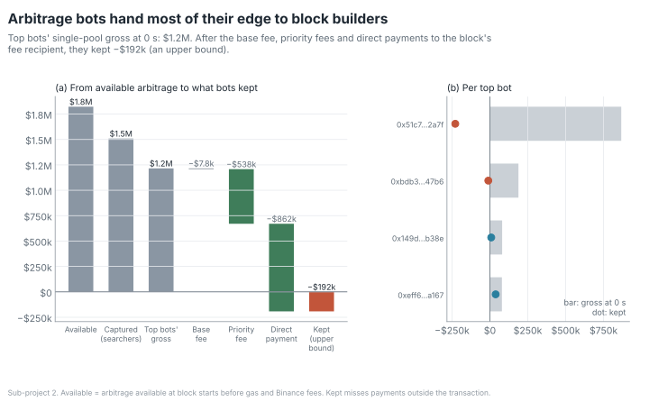

# 3. The arbitrage auction

The answer

**The edge is bid away to block producers.** The four top bot contracts made $1.22M gross at the
block time and paid $1.40M to block builders. Of the $4.14M of LVR on searcher swaps, 34.8% ended
with builders and proposers, and searchers kept nothing measurable: **−$0.20M**, an upper bound.

$1.82Mavailable at block starts (no Binance fee)

$1.51Mcaptured: all searchers' markouts at the block time

115%builder payments as a share of the top bots' gross at 0 s (95% at 12 s)

−$0.20Mkept by searchers (upper bound)

<figure markdown>

</figure>

## The top bots pay builders more than they make

- The four top bot contracts' single-pool transactions made **$1.22M** gross at 0 s and paid
  **$1.40M** to block builders: builder income is 115% of gross at 0 s and 95% at 12 s.
- Per contract, the largest pays builders 1.26 times its gross; the two smallest pay 0.89 and 0.52
  times theirs and keep $8,867.73 and $38,004.34.
- Captured is 82.8% of available, but not a subset of it: it also counts searchers trading after
  other swaps in the same block, and strategies other than CEX-DEX arbitrage.

From available to kept, step by step (USD millions)

| Step | USD millions |
|---|--:|
| Available at block starts, no Binance fee | 1.82 |
| Available with a 1 bp Binance fee | 1.45 |
| Captured: all searchers' 0 s markouts | 1.51 |
| Top bots, single-pool transactions: gross | 1.22 |
| − base fee burned | 0.01 |
| − priority fees | 0.54 |
| − direct coinbase payments | 0.86 |
| = kept (upper bound) | −0.19 |
| Same costs against the 12 s markout: gross | 1.47 |
| = kept at 12 s (upper bound) | 0.06 |

## Where the LVR on searcher swaps ends up

Every searcher swap, as shares of the **$4.14M** of LVR on them (the home page's chart draws this
split):

| Destination | Share | USD |
|---|--:|--:|
| LPs, as fees | 47.7% | |
| protocol fees | 15.9% | |
| **block builders** | **20.5%** | $848,648.09 |
| **proposers** | **14.4%** | $594,782.47 |
| multi-pool transactions' gross (not split) | 6.2% | |
| gas burned | 0.2% | |
| **kept by searchers** | **−4.9%** | −$201,569.88 |

Kept is negative because the builder and proposer payments (34.83% of searcher LVR) exceed the
single-pool gross at 0 s (30.20%).

## How the proposer/builder split was tested

A block's last transaction is its payment to the proposer, sent by the fee recipient or by a
payout address learned from chain data
([method](../how/methodology/destination.md#19-proposer-payment-detection)). The rule was tested
twice on blind relay holdouts, each with its bar fixed before the holdout was drawn: 95% of the
found payout-class blocks must match the relay's payment within 1 wei, and pass a check that the
relay's proposer was the one paid.

The first recipient check **failed** on one contract: 615 of its 616 failures were payments into
`0xfeeeeee…7ffc`, which passes the whole payment on. Redefining that check and re-scoring the same
blocks would have been fishing. Instead a check that follows the payment through the transaction
was written down and tagged (`forwarder-preregistered`) before a fresh holdout was drawn; it passed
290 of 290. The first decision stays on file as the record of the first test
([method](../how/methodology/destination.md#20-recipient-check-through-forwarders)). Blocks left
unexplained hold $630.11 (0.044%) of builder dollars.

The two holdouts side by side

| | first holdout (seed 44) | second holdout (seed 45) |
|---|---|---|
| payout-class blocks found on a relay | 289 | 290 |
| match the relay's payment within 1 wei | 289 (100%) | 290 (100%) |
| recipient check | last transaction's `to_address`: 132 (45.7%) | follows forwarders: 290 (100%) |
| decision | two-sided split kept | one split |

Read with care

This does not mean the bots lose money. "Kept" is a small difference of large totals, and its sign
depends on the horizon (−$0.19M at 0 s, +$0.06M at 12 s for the top bots). Gross is measured
against Binance's last trade at the block time; the bots' own hedge price and timing, Binance
fees, inventory and hedging are not observed.

Required limitations

> Builder payments are detected only as direct ETH transfers from the bot contract to the block's fee recipient within the same transaction. Payments routed elsewhere (another contract, a separate transaction in the bundle, off-chain agreements) are missed, so the reported net profit is an **upper bound** on what the bots keep. Binance-side trading fees, inventory and hedging costs are not observed.

> The split of builder payments between builder and proposer uses each block's ratio of proposer payment to builder revenue; how a builder prices an individual transaction is not observed. Proposer payments are identified as the block's last transaction, sent by the fee recipient or by a payout address learned from chain data, and tested on a blind stratified relay sample; blocks where neither applies give the proposer the whole builder revenue.

Limitations

Available arbitrage ignores gas, Binance depth and fees beyond the 1 bp sensitivity, and counts a
gap that stays open again at each block start. Failed bot transactions emit no swap, so their gas
is missed (another reason kept is an upper bound); multi-pool transactions are reported gross only.
bloXroute's max-profit relay, down throughout, left 188 sampled blocks and 75 and 78 blocks of the
two holdouts without an answer.
[All limitations →](../how/limitations.md#price-discovery-and-markouts-sub-project-2)

<small>Sources: [arbitrage](https://github.com/samuraixx-key/uniswap-lp-economics/blob/main/results/arbitrage.md) ·
[bot profit](https://github.com/samuraixx-key/uniswap-lp-economics/blob/main/results/bot_profit.md) ·
[LVR destination](https://github.com/samuraixx-key/uniswap-lp-economics/blob/main/results/lvr_destination.md) ·
method: [costs and builder payments](../how/methodology/discovery.md#5-costs-and-builder-payments),
[where LVR goes](../how/methodology/destination.md#15-where-lvr-goes)</small>
